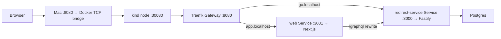

# URL shortener

A backend learning project, built in small, reviewable increments.
Commit the reviewed baseline before each increment, then review the next change as a diff.

## Current checkpoint

The Next.js page creates links through a GraphQL mutation on Fastify. The REST
creation route and GraphQL mutation share URL validation and code allocation.
`GET /:code` looks up the destination and redirects to it.

## Run the whole stack in Docker

With Colima running and Docker Compose and Buildx installed:

```sh
pnpm stack:up
```

Open [Shortlink](http://127.0.0.1:3101). The containerized Fastify server is on
`127.0.0.1:3100`, so the existing host dev servers can keep using ports 3000
and 3001. Compose starts Postgres, waits for the migration container to finish,
then starts Fastify and Next.js. A first run copies `.env.example` to `.env`
if needed. `pnpm stack:down` stops the stack and keeps the Postgres volume.

Inside the Docker network, Fastify reaches `postgres:5432` and Next.js
forwards `/graphql` to `redirect-service:3000`. The browser sees host ports;
containers talk to each other by service name. The same internal service names
are used in Kubernetes. The Kubernetes build sets a different public short-link
address for the browser bundle.

The Compose stack gives Fastify a Redis cache at `redis://redis:6379`.
Successful redirect lookups are cached for 60 seconds. When a Redis read misses
or fails, Fastify falls back to Postgres. Concurrent fallbacks for the same code
share a lookup within each Fastify process. The request that starts the lookup
also fills the cache if its Redis read confirmed a miss.
Set `REDIS_CACHE_HEADER=1` when running `pnpm stack:up` to see `X-Cache: HIT`
on a Redis hit or `X-Cache: COALESCED` on a redirect that waited for another
request's lookup. Set `REDIS_URL` to an empty value to disable caching in Compose.

Each Fastify process opens its Redis read circuit after five consecutive read
errors or timeouts. For one second, requests go directly to the coalesced
Postgres fallback. After the cooldown, one request probes Redis while concurrent
requests continue through the fallback. A successful reply, including a cache
miss, closes the circuit. A failed probe starts another one-second cooldown.
Open and closed transitions are logged. Replies from earlier attempts can
complete their own requests while recovery proceeds independently.

Redirects that need Postgres return `503` when the pool has 128 waiting
checkouts or when acquiring a connection takes 50 ms. Configure these per-process
limits with `REDIRECT_DB_MAX_WAITERS` and `REDIRECT_DB_CHECKOUT_TIMEOUT_MS`.
Cache hits and requests sharing an existing lookup bypass checkout. Link
creation uses the same pool and its normal checkout path.

After a redirect's checkout deadline expires, pg can retain its waiter until a
connection arrives or pg's own timeout fires. The waiter counts toward the queue
cap. A late connection is released immediately so the expired request performs
no query.

## Run in local Kubernetes

With Colima running and `kind` and `kubectl` installed, run:

```sh
pnpm k8s:up
```

Open [Shortlink](http://app.localhost:8080). Created short links use
`http://go.localhost:8080/<code>`. These `.localhost` names resolve to loopback in
modern browsers, so no hosts-file changes are needed.

`k8s:up` builds the application images, loads them into the `shortlink` kind cluster,
starts a separate Postgres with its own volume, waits for the migration Job,
and deploys Fastify, Next.js, and a Traefik Gateway. It then starts a background
Docker TCP bridge on `127.0.0.1:8080`. You can close the terminal; no interactive
port-forward is required. The kubeconfig stays in the ignored `.kind/` directory,
so the commands do not switch your default Kubernetes context.

The existing kind node was created without a Docker mapping for HTTP traffic.
The bridge connects to its NodePort over Docker's `kind` network, preserving the
cluster and its database. HAProxy forwards TCP bytes; Traefik performs the HTTP
hostname routing inside Kubernetes. Both use pinned image versions.



The Service boxes show routing references. Traefik discovers their pod endpoints
and forwards requests to those pods; Next.js uses the internal API Service address.

The [controller manifest](deploy/k8s/gateway-controller.yaml) installs Traefik
and gives it permission to read routing resources and report their status.
The [routing manifest](deploy/k8s/gateway.yaml) separates three concepts:

- `GatewayClass` chooses the implementation: Traefik.
- `Gateway` declares an HTTP listener and permits routes from the same namespace.
- `HTTPRoute` selects the backend Service by hostname. Kubernetes Services still
  provide stable internal destinations while their pods change.

GraphQL stays on the UI's origin: the browser calls `app.localhost:8080/graphql`,
and Next.js forwards to `http://redirect-service:3000/graphql` internally.
The UI's generated short-link origin is compiled by Next.js, so `k8s:up` supplies
`NEXT_PUBLIC_SHORT_LINK_ORIGIN=http://go.localhost:8080` as a Docker build argument.
Setting this variable only on a running web pod would not change its browser bundle.

The first run downloads the pinned Gateway API v1.6.3 standard CRDs into `.kind/`.
The CRDs define the Kubernetes resource types; the running controller makes those
resources work. `k8s:up` waits for the controller, Gateway, and accepted routes,
then checks both public hosts. To reconcile just the Gateway and bridge later:

```sh
pnpm k8s:gateway
```

To stop the local entrypoint while leaving Kubernetes and its data running:

```sh
pnpm k8s:gateway:down
```

Inspect the routing and its controller:

```sh
kubectl --kubeconfig .kind/kubeconfig -n shortlink get pods,services,jobs,pvc
kubectl --kubeconfig .kind/kubeconfig -n shortlink get gatewayclass,gateway,httproute
kubectl --kubeconfig .kind/kubeconfig -n shortlink logs deployment/gateway-controller
docker compose -f deploy/kind/compose.yaml ps
```

The [local manifests](deploy/k8s/) use a migration Job and separate Fastify
readiness (`/readyz`) and liveness (`/healthz`) probes. The kind database is
independent of the Compose database; deleting the kind cluster also deletes its
local volume. This local Gateway uses HTTP on a loopback port. A deployed setup
would give its Gateway a reachable load balancer and configure DNS and TLS.

`pnpm k8s:forward` remains available for direct debugging on ports 3100 and 3101.
Stop the Compose stack first if it occupies those ports. This optional command
stays in the foreground and stops its forwards when you press Ctrl+C.

Verified locally: existing database rows and PVC survived deployment; the browser
created and copied a `go.localhost` link through GraphQL; visiting that link
returned the correct `302`, `Location`, and `Cache-Control: no-store`. Missing
codes and unmatched hostnames returned `404`. Gateway setup also passed a rerun.

## Inspect application metrics

Fastify now records metrics using the pinned official Node.js client,
`@prometheus-io/client`. Each application instance owns a registry in memory.
The `onResponse` hook counts completed responses and observes their Fastify
duration. A second Fastify listener serves the registry at `/metrics` on port
9090. Closing the application also closes that listener before ending the pool.

| Metric                                    | Type      | Meaning                                                              |
| :---------------------------------------- | :-------- | :------------------------------------------------------------------- |
| `shortlink_http_requests_total`           | Counter   | Completed responses by HTTP method, route template, and status code. |
| `shortlink_http_request_duration_seconds` | Histogram | Response durations in seconds, using the same labels.                |
| `shortlink_db_pool_connections`           | Gauge     | Existing pool clients with `state="idle"` or `state="in_use"`.       |
| `shortlink_db_pool_waiting_requests`      | Gauge     | Checkouts currently waiting in the pg pool queue.                    |

Counters and histograms accumulate until the process restarts. Pool gauges read
`totalCount`, `idleCount`, and `waitingCount` when scraped; collecting them opens
no connections and runs no SQL. `in_use` is `totalCount - idleCount`, which includes
clients still connecting and is not a count of active SQL queries. These are
snapshots, so a periodic scrape can miss a short queue spike.

Route labels use `/:code`, `/links`, `/graphql`, or `unmatched`; they contain no
short codes, destinations, request bodies, or query strings. Uncommon HTTP
methods are grouped as `OTHER`. Health/readiness probes and requests to the
separate metrics listener are excluded from application HTTP metrics.

The histogram has a bucket at `0.1` seconds. Its count gives the exact number of
observed server responses at or below 100 ms; later, Prometheus can estimate
percentiles from all the buckets. This measures Fastify time, while our performance
target measures client time and correct redirects. HTTP status is also separate
from GraphQL operation success: an error inside an HTTP `200` response is counted
as HTTP `200`. Operation-outcome metrics can be added in a later increment.

With `pnpm dev` running on the host:

```sh
curl http://127.0.0.1:9090/metrics
```

The host listener uses `METRICS_PORT` if supplied; containers use port 9090.
Compose leaves this port unpublished. In Kubernetes, the internal
`redirect-metrics:9090` Service selects the Fastify pods. It publishes unready
pods too, so application readiness failures do not hide monitoring. The normal
`redirect-service:3000` Service continues to select ready endpoints for user
traffic. The Gateway references only that application port.

After `pnpm k8s:up`, inspect metrics from inside a pod:

```sh
kubectl --kubeconfig .kind/kubeconfig -n shortlink exec deployment/web -- \
  node -e 'fetch("http://redirect-metrics:9090/metrics").then(r => r.text()).then(console.log)'
```

For temporary access from the Mac, forward only the private metrics Service in
one terminal, then run curl in another:

```sh
kubectl --kubeconfig .kind/kubeconfig -n shortlink port-forward \
  --address 127.0.0.1 service/redirect-metrics 19090:9090
```

```sh
curl http://127.0.0.1:19090/metrics
```

A response after two successful redirects might include:

```text
shortlink_http_requests_total{method="GET",route="/:code",status_code="302"} 2
shortlink_db_pool_connections{state="in_use"} 0
shortlink_db_pool_connections{state="idle"} 1
shortlink_db_pool_waiting_requests 0
```

At this checkpoint the application exposes measurements; Prometheus history
collection and Grafana dashboards come in the next increment. The registry is
per process, so that collection must scrape individual pods when we add replicas.

## Run the services on the host for development

Prerequisites: Node.js 26.13.0, pnpm 12.18.0, Colima, Docker CLI, and Docker Compose.

```sh
colima start
test -f .env || cp .env.example .env
pnpm install --frozen-lockfile
pnpm db:up
pnpm db:migrate
pnpm dev
```

The server listens on `127.0.0.1:3000`. In another terminal:

```sh
curl -i http://127.0.0.1:3000/healthz
curl -i http://127.0.0.1:3000/readyz

docker compose exec postgres psql -U shortener -d shortener -c 'SELECT 1 AS connected;'
```

If you already have a `.env` from increment 1, add `DATABASE_URL` from
`.env.example` and adjust it if you changed the local database credentials.
Fastify and Drizzle Kit read the root `.env` locally. An exported `DATABASE_URL`
takes precedence, so check which database it points to before applying migrations.

To see the difference between the two probes, run `docker compose stop postgres`
while Fastify is running. `/healthz` stays `200`; `/readyz` returns `503`. Run
`pnpm db:up` to bring Postgres back and check that `/readyz` returns `200` again
without restarting Fastify.

## Create a link

Keep the Fastify server running and start Next.js in a second terminal:

```sh
pnpm dev:web
```

Open [Shortlink](http://127.0.0.1:3001), paste a destination URL, and click
**Create link**. The page lets you open or copy the result.

The browser sends a GraphQL mutation to `/graphql` on the Next.js origin.
`apps/web/next.config.ts` forwards it to Fastify on port 3000. The resolver
calls the same link creator as the REST handler and uses the existing pool.
The redirect itself still goes to Fastify.

The web app defaults to `http://127.0.0.1:3000` for both the Fastify upstream
and generated short links. Override them separately with `REDIRECT_SERVICE_ORIGIN`
and `NEXT_PUBLIC_SHORT_LINK_ORIGIN` before starting or building the web app.

With `pnpm dev` running after `pnpm db:migrate`:

```sh
curl -i http://127.0.0.1:3000/links \
  -H 'Content-Type: application/json' \
  -d '{"targetUrl":"https://example.com/guide"}'
```

A valid request returns `201 Created` with `code`, `targetUrl`, and `createdAt`.
See the saved row in `pnpm db:studio`. The request must contain an absolute HTTP
or HTTPS URL without credentials, up to 2,048 characters.

Fastify validates the request before touching the database. Drizzle uses the
existing pool to try an `INSERT … ON CONFLICT (code) DO NOTHING RETURNING …`.
If an eight-character random code is already taken, the insert returns no row,
so Fastify tries another candidate. It makes at most three insert attempts and
returns `503` if all three collide. An unrelated database failure ends the request
immediately.

## Visit a short link

Replace `YOUR_CODE` with the code returned by `POST /links`:

```sh
curl -i http://127.0.0.1:3000/YOUR_CODE
```

The response is `302 Found` with the destination in `Location`. Both the
redirect and a missing code's `404` carry `Cache-Control: no-store`. Each
request reaching the service reads the current destination from Postgres.

## Review the scaffold

- `apps/redirect-service/src/app.ts` creates the Fastify instance and defines routes.
  It creates one pool shared across requests and closes it in `onClose`, after
  active HTTP requests finish. `/readyz` runs `SELECT 1` through this pool.
- `apps/redirect-service/src/database.ts` validates the database URL and configures
  the pool. Connections open on demand, up to five per app instance. The driver
  limits the wait for a connection and for a query result to 500 ms each. Start with
  these local settings and revisit them when measuring redirect load.
- `apps/redirect-service/src/server.ts` opens the HTTP port and closes the app on
  SIGINT (Ctrl+C) or SIGTERM. Its `.js` import points to the JavaScript file that
  TypeScript emits; `tsx` also resolves it during development.
- `compose.yaml` runs Postgres on the Mac's loopback port 5432. The app runs on the
  Mac, so it will connect to `127.0.0.1:5432`. A container on the same Compose
  network would use `postgres:5432` instead.
- The `postgres_data` Docker volume persists database files when the container is
  replaced. Postgres 18 stores its data beneath `/var/lib/postgresql`.
- `.env` supplies the initialization credentials to Compose and the connection
  URL to Fastify. Git ignores it. Changing the initialization credentials later
  does not change users in an existing volume.
- `packages/db` owns the schema, migrations, and the typed link queries. Its
  `createLinkStore` wraps the pool owned by Fastify.
- Dependencies use exact versions; `pnpm-lock.yaml` records transitive dependencies.

## Review a database migration

`packages/db/src/schema.ts` describes the intended table. The generated SQL in
`packages/db/migrations` is what Postgres runs. Read it before applying it: Postgres
generates the internal ID and creation time, requires a destination URL and code,
and rejects duplicate codes with `links_code_unique`.

```sh
pnpm db:migrate
docker compose exec postgres psql -U shortener -d shortener -c '\d links'
```

For the browser UI, run `pnpm db:studio` while Postgres is running and open
[Drizzle Studio](https://local.drizzle.studio). Select `public` → `links`, then
use **Structure** to inspect the table or **Data** to view its rows.

Drizzle records applied migrations in `drizzle.__drizzle_migrations`, so running
`pnpm db:migrate` again skips steps already applied. Fastify does not run migrations
on startup. When changing the schema, run `pnpm db:generate --name=describe_change`,
review the new SQL, and keep it with the generated metadata in Git. Add a new
migration for subsequent changes rather than editing one already applied.

## Check and build

```sh
pnpm test
pnpm lint
pnpm typecheck
pnpm build
pnpm start
```

The route tests call Fastify's `inject()` with fake link queries, so they
need neither a listening server nor Postgres. They verify the HTTP behavior and
retry policy.

`pnpm test:integration` uses Testcontainers to start fresh Postgres and Redis
containers. It runs `db:migrate`, verifies redirects for codes created via REST
and GraphQL, and checks cache hits, expiry configuration, and Redis timeouts.
It closes Fastify and stops both containers when finished.

On Colima, start the VM and run the same command:

```sh
colima start
pnpm test:integration
```

The command reads the socket from the active Colima Docker context when
`DOCKER_HOST` is unset. An explicitly configured Docker host takes precedence.

`pnpm dev` builds the database workspace package, then uses `tsx` to run the
service and restart on edits. Restart `pnpm dev` after changing the database
package. `pnpm build` compiles both packages; `pnpm start` runs the service's
compiled JavaScript with Node.
Stop the development server before starting the compiled server on the same port.

## Stop locally

Press Ctrl+C in the server terminal, then:

```sh
pnpm db:down
colima stop
```

`db:down` retains the data volume. `docker compose down --volumes` deletes local
database data and should only be used when intentionally resetting it.

## Benchmark redirects

With Colima running:

```sh
pnpm bench:redirect
```

This starts a separate Compose project, migrates an empty Postgres database,
and seeds 1,000 links. k6 sends requests directly to `redirect-service:3000`
on the private Compose network. The test starts neither Next.js nor a port
forward and removes its containers and database volume when it finishes.

After a short warm-up, the test schedules 50, 150, then 300 requests per second
for 10 seconds each. It starts requests at the requested rate even if the
server slows down. It checks `302` and the expected `Location` header without
following the redirect.

Read `http_reqs` for achieved request rate, `http_req_duration` for latency,
and `checks_failed` for incorrect redirects. A dropped iteration means k6
could not start a scheduled request with the available virtual users. It is
separate from a request that reached Fastify and failed.

For a short check, run `BENCH_RATES=5 BENCH_SECONDS=1 pnpm bench:redirect`.
See [benchmark results](benchmarks/README.md) for the recorded baseline.

References: [Fastify app/server separation](https://fastify.dev/docs/latest/Guides/Testing/),
[node-postgres pooling](https://node-postgres.com/features/pooling),
[Drizzle migrations](https://orm.drizzle.team/docs/drizzle-kit-migrate),
[GraphQL Yoga with Fastify](https://the-guild.dev/graphql/yoga-server/docs/integrations/integration-with-fastify),
[Next.js rewrites](https://nextjs.org/docs/app/api-reference/config/next-config-js/rewrites),
[Testcontainers on Colima](https://node.testcontainers.org/supported-container-runtimes/#colima),
[Traefik Gateway API](https://doc.traefik.io/traefik/reference/routing-configuration/kubernetes/gateway-api/),
[kind host networking](https://kind.sigs.k8s.io/docs/user/quick-start/#mapping-ports-to-the-host-machine),
[Prometheus Node.js client](https://github.com/prometheus/client_js),
[Fastify response hooks](https://fastify.dev/docs/latest/Reference/Hooks/#onresponse),
[Postgres image configuration](https://hub.docker.com/_/postgres).
