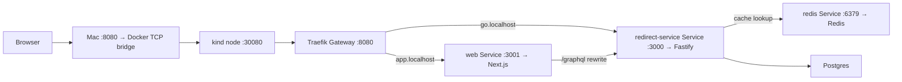

# URL shortener

A backend learning project, built in small, reviewable increments.
Commit the reviewed baseline before each increment, then review the next change as a diff.

## Current checkpoint

The Next.js page creates links through a GraphQL mutation on Fastify. The REST
creation route and GraphQL mutation share URL validation and code allocation.
`GET /:code` looks up the destination and redirects to it.

## Run the whole stack in Docker

With Colima running and Docker Compose and Buildx installed:

```sh
pnpm stack:up
```

Open [Shortlink](http://127.0.0.1:3101). The containerized Fastify server is on
`127.0.0.1:3100`, so the existing host dev servers can keep using ports 3000
and 3001. Compose starts Postgres, waits for the migration container to finish,
then starts Fastify and Next.js. A first run copies `.env.example` to `.env`
if needed. `pnpm stack:down` stops the stack and keeps the Postgres volume.

Inside the Docker network, Fastify reaches `postgres:5432` and Next.js
forwards `/graphql` to `redirect-service:3000`. The browser sees host ports;
containers talk to each other by service name. The same internal service names
are used in Kubernetes. The Kubernetes build sets a different public short-link
address for the browser bundle.

The Compose stack gives Fastify a Redis cache at `redis://redis:6379`.
Successful redirect lookups are cached for 60 seconds. When a Redis read misses
or fails, Fastify falls back to Postgres. Concurrent fallbacks for the same code
share a lookup within each Fastify process. The request that starts the lookup
also fills the cache if its Redis read confirmed a miss.
Set `REDIS_CACHE_HEADER=1` when running `pnpm stack:up` to see `X-Cache: HIT`
on a Redis hit or `X-Cache: COALESCED` on a redirect that waited for another
request's lookup. Set `REDIS_URL` to an empty value to disable caching in Compose.

Each Fastify process opens its Redis read circuit after five consecutive read
errors or timeouts. For one second, requests go directly to the coalesced
Postgres fallback. After the cooldown, one request probes Redis while concurrent
requests continue through the fallback. A successful reply, including a cache
miss, closes the circuit. A failed probe starts another one-second cooldown.
Open and closed transitions are logged. Replies from earlier attempts can
complete their own requests while recovery proceeds independently.

Redirects that need Postgres return `503` when the pool has 128 waiting
checkouts or when acquiring a connection takes 50 ms. Configure these per-process
limits with `REDIRECT_DB_MAX_WAITERS` and `REDIRECT_DB_CHECKOUT_TIMEOUT_MS`.
Cache hits and requests sharing an existing lookup bypass checkout. Link
creation uses the same pool and its normal checkout path.

After a redirect's checkout deadline expires, pg can retain its waiter until a
connection arrives or pg's own timeout fires. The waiter counts toward the queue
cap. A late connection is released immediately so the expired request performs
no query.

## Run in local Kubernetes

With Colima running and `kind` and `kubectl` installed, run:

```sh
pnpm k8s:up
```

Open [Shortlink](http://app.localhost:8080). Created short links use
`http://go.localhost:8080/<code>`. These `.localhost` names resolve to loopback in
modern browsers, so no hosts-file changes are needed.

`k8s:up` builds the application images, loads them into the `shortlink` kind cluster,
starts a separate Postgres with its own volume and a disposable Redis cache, waits for the migration Job,
and deploys Fastify, Next.js, and a Traefik Gateway. It then starts a background
Docker TCP bridge on `127.0.0.1:8080`. You can close the terminal; no interactive
port-forward is required. The kubeconfig stays in the ignored `.kind/` directory,
so the commands do not switch your default Kubernetes context.
The same command also provisions local Prometheus and Grafana monitoring.

The existing kind node was created without a Docker mapping for HTTP traffic.
The bridge connects to its NodePort over Docker's `kind` network, preserving the
cluster and its database. HAProxy forwards TCP bytes; Traefik performs the HTTP
hostname routing inside Kubernetes. Both use pinned image versions.



The Service boxes show routing references. Traefik discovers their pod endpoints
and forwards requests to those pods; Next.js uses the internal API Service address.

Fastify runs with two replicas, declared in `deploy/k8s/apps.yaml`. Each pod runs
its own Node.js process, Postgres pool (maximum five connections), request
coalescing map, Redis read circuit breaker, and metrics registry. Both use the
same Postgres and Redis Services. Two steady-state replicas can therefore open
up to ten pool connections; a rolling update can temporarily add more pods and
connections. Coalescing remains local to each process, so both pods may query
Postgres for the same uncached code.

The existing application Service and Gateway discover both ready pods without
new public addresses. Prometheus discovers both metrics endpoints independently.
This is horizontal application scaling within the same kind node and Colima VM;
it adds no machine capacity and does not protect against a VM restart. Existing
benchmark results do not establish the throughput of this two-replica setup.

Inspect replicas and ready application endpoints with:

```sh
kubectl --kubeconfig .kind/kubeconfig -n shortlink get deployment redirect-service
kubectl --kubeconfig .kind/kubeconfig -n shortlink get pods -l app=redirect-service -o wide
kubectl --kubeconfig .kind/kubeconfig -n shortlink get endpointslices \
  -l kubernetes.io/service-name=redirect-service
```

Fastify connects to `redis://redis:6379` through the internal Redis Service. Redis
has no Gateway route or host port. It uses the same image and cache implementation
as Compose: a successful lookup fills the cache for 60 seconds, and an unavailable
cache falls back to Postgres. Fastify readiness still checks Postgres only.
`k8s:up` waits for Redis on startup to catch deployment problems; that startup
check does not make Redis a runtime requirement for serving redirects.

The [Redis manifest](deploy/k8s/redis.yaml) runs one replica without a PVC, RDB
snapshots, or AOF persistence. Replacing that pod clears the cache; links remain
in Postgres and repopulate Redis on subsequent visits. `Recreate` rollouts avoid
temporarily routing to two independent caches. The 128 MiB container memory limit
is a local resource guard, not a Redis eviction policy or a measured cache capacity.

The local Fastify Deployment enables `REDIS_CACHE_HEADER=1`. To inspect a link
created through the UI, run this twice, replacing `<code>`:

```sh
curl --resolve go.localhost:8080:127.0.0.1 -sS -D - -o /dev/null \
  'http://go.localhost:8080/<code>'
```

The first visit to an uncached link returns the redirect from Postgres and fills
Redis, without an `X-Cache` header. A subsequent visit within its TTL returns
`X-Cache: HIT`. Both responses retain `Cache-Control: no-store`, which controls
browser caching independently of the server's Redis cache. A visit sharing an
in-flight lookup can instead report `X-Cache: COALESCED`.

Inspect Redis inside the cluster, without exposing a new port:

```sh
kubectl --kubeconfig .kind/kubeconfig -n shortlink get pods,services -l app=redis
kubectl --kubeconfig .kind/kubeconfig -n shortlink exec deployment/redis -- redis-cli ping
kubectl --kubeconfig .kind/kubeconfig -n shortlink exec deployment/redis -- \
  redis-cli TTL 'shortlink:redirect:<code>'
```

TTL reports remaining seconds, or `-2` if the key is absent. Existing Grafana
panels still show HTTP latency and database-pool state; cache hit/miss counters
and Redis-specific panels have not been added in this increment.

Verified through the Gateway on November 12, 2026: cold lookup → cache fill →
`X-Cache: HIT`, correct destination and `no-store` throughout, and a 60-second TTL.
With the Redis Deployment temporarily scaled to zero, redirects still returned
`302` and `/readyz` returned `200`. Restoring its replica produced an empty cache;
the link remained in Postgres, refilled Redis, and returned a cache hit again.
A missing code returned `404` and was not cached. These are functional smoke
checks, not a latency or throughput qualification. The full `k8s:up` also passed;
image builds caused temporary readiness timeouts in the shared Colima VM before
the stack recovered.

The [controller manifest](deploy/k8s/gateway-controller.yaml) installs Traefik
and gives it permission to read routing resources and report their status.
The [routing manifest](deploy/k8s/gateway.yaml) separates three concepts:

- `GatewayClass` chooses the implementation: Traefik.
- `Gateway` declares an HTTP listener and permits routes from the same namespace.
- `HTTPRoute` selects the backend Service by hostname. Kubernetes Services still
  provide stable internal destinations while their pods change.

GraphQL stays on the UI's origin: the browser calls `app.localhost:8080/graphql`,
and Next.js forwards to `http://redirect-service:3000/graphql` internally.
The UI's generated short-link origin is compiled by Next.js, so `k8s:up` supplies
`NEXT_PUBLIC_SHORT_LINK_ORIGIN=http://go.localhost:8080` as a Docker build argument.
Setting this variable only on a running web pod would not change its browser bundle.

The first run downloads the pinned Gateway API v1.6.3 standard CRDs into `.kind/`.
The CRDs define the Kubernetes resource types; the running controller makes those
resources work. `k8s:up` waits for the controller, Gateway, and accepted routes,
then checks both public hosts. To reconcile just the Gateway and bridge later:

```sh
pnpm k8s:gateway
```

To stop the local entrypoint while leaving Kubernetes and its data running:

```sh
pnpm k8s:gateway:down
```

Inspect the routing and its controller:

```sh
kubectl --kubeconfig .kind/kubeconfig -n shortlink get pods,services,jobs,pvc
kubectl --kubeconfig .kind/kubeconfig -n shortlink get gatewayclass,gateway,httproute
kubectl --kubeconfig .kind/kubeconfig -n shortlink logs deployment/gateway-controller
docker compose -f deploy/kind/compose.yaml ps
```

The [local manifests](deploy/k8s/) use a migration Job and separate Fastify
readiness (`/readyz`) and liveness (`/healthz`) probes. The kind database is
independent of the Compose database; deleting the kind cluster also deletes its
local volume. This local Gateway uses HTTP on a loopback port. A deployed setup
would give its Gateway a reachable load balancer and configure DNS and TLS.

`pnpm k8s:forward` remains available for direct debugging on ports 3100 and 3101.
Stop the Compose stack first if it occupies those ports. This optional command
stays in the foreground and stops its forwards when you press Ctrl+C.

Verified locally: existing database rows and PVC survived deployment; the browser
created and copied a `go.localhost` link through GraphQL; visiting that link
returned the correct `302`, `Location`, and `Cache-Control: no-store`. Missing
codes and unmatched hostnames returned `404`. Gateway setup also passed a rerun.

## Inspect application metrics

Fastify now records metrics using the pinned official Node.js client,
`@prometheus-io/client`. Each application instance owns a registry in memory.
The `onResponse` hook counts completed responses and observes their Fastify
duration. A second Fastify listener serves the registry at `/metrics` on port
9090. Closing the application also closes that listener before ending the pool.

| Metric                                            | Type      | Meaning                                                                                        |
| :------------------------------------------------ | :-------- | :--------------------------------------------------------------------------------------------- |
| `shortlink_http_requests_total`                   | Counter   | Completed responses by HTTP method, route template, and status code.                           |
| `shortlink_http_request_duration_seconds`         | Histogram | Response durations in seconds, using the same labels.                                          |
| `shortlink_db_pool_connections`                   | Gauge     | Existing pool clients with `state="idle"` or `state="in_use"`.                                 |
| `shortlink_db_pool_waiting_requests`              | Gauge     | Checkouts currently waiting in the pg pool queue.                                              |
| `shortlink_redirect_db_checkout_rejections_total` | Counter   | Rejected checkout attempts by `reason="queue_full"` or `"timeout"`.                            |
| `shortlink_redirect_db_checkout_duration_seconds` | Histogram | Checkout elapsed time by `outcome="acquired"`, `"queue_full"`, `"timeout"`, or `"error"`.      |
| `shortlink_redirect_redis_reads_total`            | Counter   | Cache read outcomes: `hit`, `miss`, or `unavailable` (failed reads and circuit bypasses).      |
| `shortlink_event_loop_delay_max_seconds`          | Gauge     | Maximum Node event-loop sampling delay since the preceding metrics scrape, at 10ms resolution. |

Counters and histograms accumulate until the process restarts. Pool gauges read
`totalCount`, `idleCount`, and `waitingCount` when scraped; collecting them opens
no connections and runs no SQL. `in_use` is `totalCount - idleCount`, which includes
clients still connecting and is not a count of active SQL queries. These are
snapshots, so a periodic scrape can miss a short queue spike.

Checkout rejection counters record events when they happen, so a scrape can
observe the accumulated count even after a short queue or delay has disappeared.
They count underlying database lookup attempts, not HTTP followers sharing a
lookup through coalescing. One rejected checkout can therefore produce several
`503` responses. The structured `Redirect database checkout rejected` log records
the reason, elapsed time, current pool counts, configured limits and the maximum
event-loop delay observed since the preceding scrape. No URL or short code is
included in this diagnostic event.

The event-loop monitor uses Node's built-in `monitorEventLoopDelay`; its samples
include the normal 10ms sampling interval and scheduling delays. A high value
shows that Node was delayed, but does not identify whether CPU scheduling, GC or
synchronous application work caused that delay. Scraping resets its maximum;
closing the metrics listener disables the monitor. `registerMetrics` returns the
listener and observer callbacks, which `buildApp` passes into checkout and cache
handling without adding a Prometheus dependency to those helpers.

In Grafana Explore, select **Shortlink Prometheus** and inspect these queries:

```promql
sum by (pod, reason) (increase(shortlink_redirect_db_checkout_rejections_total[1m]))
```

```promql
shortlink_event_loop_delay_max_seconds
```

```promql
sum by (pod, outcome) (rate(shortlink_redirect_redis_reads_total[30s]))
```

The existing dashboard panels remain unchanged. A minute-long `increase` is an
extrapolated estimate; use counter values and the retained rejection logs for
exact incident counts.

Route labels use `/:code`, `/links`, `/graphql`, or `unmatched`; they contain no
short codes, destinations, request bodies, or query strings. Uncommon HTTP
methods are grouped as `OTHER`. Health/readiness probes and requests to the
separate metrics listener are excluded from application HTTP metrics.

The HTTP duration histogram has a bucket at `0.1` seconds. Its count gives the exact number of
observed server responses at or below 100 ms; later, Prometheus can estimate
percentiles from all the buckets. This measures Fastify time, while our performance
target measures client time and correct redirects. HTTP status is also separate
from GraphQL operation success: an error inside an HTTP `200` response is counted
as HTTP `200`. Operation-outcome metrics can be added in a later increment.

With `pnpm dev` running on the host:

```sh
curl http://127.0.0.1:9090/metrics
```

The host listener uses `METRICS_PORT` if supplied; containers use port 9090.
Compose leaves this port unpublished. In Kubernetes, the internal
`redirect-metrics:9090` Service selects the Fastify pods. It publishes unready
pods too, so application readiness failures do not hide monitoring. The normal
`redirect-service:3000` Service continues to select ready endpoints for user
traffic. The Gateway references only that application port.

After `pnpm k8s:up`, inspect metrics from inside a pod:

```sh
kubectl --kubeconfig .kind/kubeconfig -n shortlink exec deployment/web -- \
  node -e 'fetch("http://redirect-metrics:9090/metrics").then(r => r.text()).then(console.log)'
```

For temporary access from the Mac, forward only the private metrics Service in
one terminal, then run curl in another:

```sh
kubectl --kubeconfig .kind/kubeconfig -n shortlink port-forward \
  --address 127.0.0.1 service/redirect-metrics 19090:9090
```

```sh
curl http://127.0.0.1:19090/metrics
```

A response after two successful redirects might include:

```text
shortlink_http_requests_total{method="GET",route="/:code",status_code="302"} 2
shortlink_db_pool_connections{state="in_use"} 0
shortlink_db_pool_connections{state="idle"} 1
shortlink_db_pool_waiting_requests 0
```

The registry is per process. The monitoring configuration below discovers and
scrapes individual pods, preserving that separation when replicas are added.

## View Grafana dashboards and generate traffic

With the Kubernetes stack running, provision or update monitoring with:

```sh
pnpm monitoring:up
```

This also runs as part of `pnpm k8s:up`. Open the
[Shortlink dashboard](http://grafana.localhost:8080/d/shortlink-overview/shortlink-overview).
It observes the Fastify pods in the kind cluster, reached by the Gateway URLs.

Log in as **admin**. The first installation generates a random password in the
ignored `.kind/grafana-admin.env` file and creates the Kubernetes Secret
`grafana-admin`. Retrieve the initial password with:

```sh
kubectl --kubeconfig .kind/kubeconfig -n shortlink get secret grafana-admin \
  -o jsonpath='{.data.GF_SECURITY_ADMIN_PASSWORD}' | base64 -d
```

`scripts/monitoring-up.sh` creates the Secret once. The Grafana Deployment in
`deploy/k8s/monitoring.yaml` reads it as `GF_SECURITY_ADMIN_USER` and
`GF_SECURITY_ADMIN_PASSWORD` environment variables. Grafana persists its account
in its own database on a PVC; editing the initial-password file or Secret alone
does not rotate an existing account's password.

The new infrastructure dependencies are pinned to **Prometheus v3.16.0** and
**Grafana 13.3.1**. Prometheus remains internal; Grafana uses the existing Gateway
at `grafana.localhost:8080`. Each component has a 1 GiB PVC. Prometheus retains
history for up to 24 hours, bounded to 256 MB of retained blocks. The monitoring
startup waits for both deployments and healthy Fastify scrape targets.

The checked-in files have distinct jobs:

| File                                        | Purpose                                                                          |
| :------------------------------------------ | :------------------------------------------------------------------------------- |
| `deploy/monitoring/prometheus.yaml`         | Discover the metrics Service's pod endpoints and scrape each every five seconds. |
| `deploy/monitoring/grafana-datasource.yaml` | Connect Grafana to the internal Prometheus API.                                  |
| `deploy/monitoring/grafana-dashboards.yaml` | Load dashboards from files.                                                      |
| `deploy/monitoring/shortlink.json`          | Define panels and their PromQL queries.                                          |
| `deploy/k8s/monitoring.yaml`                | Deploy the collector, UI, storage, discovery permissions, and Grafana route.     |

Prometheus queries each pod on port 9090. Grafana asks Prometheus for the recorded
history; viewing a chart does not scrape Fastify directly. The dashboard shows
request rates, server latency percentiles, HTTP statuses, cumulative `5xx`
responses in current pods, and database-pool state. Its 30-second rate windows
smooth and lag the load stages. Histogram percentiles are estimates; the client
latency target still needs client measurements.

The **Overview** combines all Fastify pods. **Pods (details)** filters the lower
section, which shows current scrape health, scrape history, redirect traffic and
p99 latency, pool clients and waiting checkouts, and `5xx` rates per pod. Select
one pod to inspect it or **All** to compare replicas; the overview remains global.
Current scrape health uses an instant query, while history charts use range
queries. The selector includes pod names observed within the chosen time range.
A chart can therefore have three colors after a replacement even when only two
pods run now. A replaced pod's historical series remains until it falls outside
the selected time range or Prometheus retention.

**Scrape targets up** and **Failed scrapes** count currently discovered targets.
They do not compare against the Deployment's desired replica count. A removed
target disappears from discovery; it does not stay present as a failed scrape.
Likewise, `UP` means the metrics listener answered, not that `/readyz` passes or
redirects work end to end. This dashboard adds no Kubernetes readiness collector
or synthetic availability probe. Pod p99 values preserve the `pod` and `le`
labels when combining histogram buckets; they are not averages of percentiles.

For dashboard-only changes, update the mounted ConfigMap without restarting
Prometheus or Grafana:

```sh
kubectl --kubeconfig .kind/kubeconfig --context kind-shortlink -n shortlink \
  create configmap grafana-dashboards \
  --from-file=shortlink.json=deploy/monitoring/shortlink.json \
  --dry-run=client -o yaml | \
  kubectl --kubeconfig .kind/kubeconfig --context kind-shortlink -n shortlink apply -f -
```

Allow time for Kubernetes to refresh the mounted ConfigMap and Grafana's
10-second provisioning poll, then reload the dashboard. `pnpm monitoring:up`
remains the command to reconcile the complete monitoring setup.

Run the demonstration load:

```sh
pnpm load:demo
```

The 225-second k6 scenario ramps through 100 → 500 → 1,000 → 100 redirects/s,
plus one GraphQL link creation/s. Five percent of visits deliberately request
missing codes. Setup creates 50 fixture links through REST, and the scenario
creates about 225 additional links through GraphQL. It validates redirect
destinations without following them. These demo records remain in the local DB.

The script uses a native `k6` when it is on `PATH`. Otherwise it runs the pinned
`grafana/k6:2.3.0` Docker image on the kind network. The Docker runner shares the
VM's resources with the application. Both paths traverse the TCP bridge and the
same Gateway routes. The first run below used native k6 on the Mac.

The summary is saved to `.kind/observability/last-summary.json`. After a successful
run, `.kind/observability/last-run.json` includes a dashboard URL with the exact
recorded time window. Select **Last 15 minutes** in Grafana to return to a live
view before another run. These results describe this local setup with monitoring
running; the demo is not a throughput-ceiling qualification.

The November 11, 2026 demonstration completed with:

| Measurement                               | Result |
| :---------------------------------------- | -----: |
| Total link visits                         | 98,999 |
| Existing-link visits                      | 94,049 |
| Correct `302` responses                   | 94,048 |
| Unexpected `503` responses                |      1 |
| Deliberate missing-code visits, all `404` |  4,950 |
| GraphQL creations, all successful         |    225 |
| Dropped starts                            |      0 |
| Existing-link client p99                  |  12 ms |

Grafana's recorded rate reached approximately 1,000 redirects/s. All twelve panel
queries returned time-series data, and history, provisioning, and login survived
a monitoring restart. The Docker runner's network path and summary output also
passed a one-request smoke check.

The pool waiting gauge stayed at zero at scrape times. That does not rule out a
short queue between five-second samples. The `5xx` total shows the single `503`;
its rate chart can miss the first event of a newly observed status series when
the initial counter sample is already one. This is why the dashboard includes
both cumulative totals and rates. A Grafana screenshot and query-check results
are saved under `.kind/observability/`.

## Monitor Colima and Kubernetes resources

The separate **Shortlink resources** dashboard is provisioned from
`deploy/monitoring/resources.json`. After resource-monitoring deployment, open:

```text
http://grafana.localhost:8080/d/shortlink-resources/shortlink-resources
```

The application dashboard remains focused on HTTP behavior and database pools.
The resource dashboard covers VM CPU count, utilization and time modes; memory
total and available; CPU, memory and I/O pressure stalls; Kubernetes allocatable
resources; container requests and limits; per-pod CPU and memory usage, restarts,
and readiness. **Namespaces (workloads)** filters only workload panels; the VM
and cluster-allocation sections always show the complete local environment.

The three metric sources have separate responsibilities:

| Source                                               | What it measures                                                                       | Access                                                                             |
| :--------------------------------------------------- | :------------------------------------------------------------------------------------- | :--------------------------------------------------------------------------------- |
| Node Exporter v1.12.1 (`vm-metrics`)                 | Selected VM-wide CPU, memory, load and PSI counters                                    | No Kubernetes token or host mounts; ordinary pod reading selected `/proc` counters |
| Existing kubelet `/metrics/resource`                 | Actual container CPU time and memory working sets                                      | Prometheus token, verified TLS with kind's public kubelet serving-CA bundle        |
| kube-state-metrics v2.20.0 (`cluster-state-metrics`) | Node capacity/allocatable, container requests/limits, pod readiness and restart counts | Read-only watches of Node and Pod objects                                          |

Kubernetes provides the usage endpoint, but it does not retain this history or
provide these Grafana views by itself. `kubectl describe node` shows current
capacity and declared allocations. `kubectl top` requires Metrics Server, which
is not installed in this cluster. Metrics Server supplies the resource Metrics
API used by tools and autoscaling; it is not required for Prometheus to scrape
the existing kubelet endpoint. See the official
[resource metrics pipeline](https://kubernetes.io/docs/tasks/debug/debug-cluster/resource-metrics-pipeline/).

This deployment is specific to our **single-node kind cluster inside Colima**.
The node and VM share a Linux kernel. CPU count, `/proc/meminfo`, and memory PSI
read inside an ordinary pod were compared with `colima ssh` and matched the VM
counters. Node Exporter enables only CPU, meminfo, loadavg and pressure collectors;
it does not claim to monitor host filesystems, interfaces, disks, or individual
processes. Its pod is pinned to `shortlink-control-plane`. A multi-node or
multi-VM deployment needs a different collector layout and host configuration.
VM and node capacity are overlapping views, not additive resource pools. These
metrics describe the Linux guest, not macOS host pressure or physical-core use.

Provisioning with `pnpm monitoring:up` applies
`deploy/k8s/resource-metrics.yaml`, copies only the public kubelet certificate
chain to a ConfigMap, mounts it into Prometheus, and adds three scrape jobs.
Kubelet scrapes verify the serving CA and the DNS identity
`shortlink-control-plane` while discovery connects to the node IP. The existing
internal-only Services expose the exporters inside the cluster; there are no
new Gateway routes or host ports. The same setup runs through `pnpm k8s:up`.

Review the access changes before applying them:

- ServiceAccount `shortlink/cluster-state-metrics`: `get`, `list`, and `watch`
  **Nodes and Pods across the cluster**. Pod reads include workload configuration;
  they grant no Secret API access. Deployment objects are not needed or watched.
- Existing ServiceAccount `shortlink/prometheus`: `get`, `list`, and `watch`
  Nodes for discovery, plus `get` on `nodes/metrics` for
  **`shortlink-control-plane` only**. It receives no `nodes/proxy` access.
- Node Exporter has its Kubernetes token mount disabled. Neither collector uses
  host namespaces, privileged mode, host mounts, or the Docker socket.

The two collectors request **40 MiB RAM and 20m CPU combined**, with memory
limits of 64 MiB and 96 MiB. These are configured requests/limits, not measured
overhead. New time series also consume Prometheus memory and storage. The
collectors appear in their own workload charts after deployment. On this small
VM, check their actual costs before another load trial.

Allocation queries sum **scheduled Pending/Running regular containers** and
exclude completed Jobs. They omit init containers and Pod overhead, so they are
not scheduler-exact effective Pod requests. An absent limit means unbounded,
not a zero-resource ceiling. Configured limit totals may exceed VM capacity
without reserving that amount. Working-set memory, process RSS, and VM total
minus available are different measurements; use VM available memory and pressure
alongside client behavior when sizing the backing VM.

Active Pod state is matched by Pod UID and must come from the latest successful
cluster-state scrape. This prevents an old Pod retained in Prometheus lookback
after a collector restart from inflating current allocation, memory, and readiness
counts. Kubelet memory gauges use the same active-Pod filter by namespace/name;
the resource endpoint does not provide Pod UID labels.
The setup script also avoids requesting a second replacement when applying a
changed monitoring pod template has already started one.

Pressure Stall Information measures time spent waiting for CPU, memory, or I/O,
not utilization. `some` and `full` overlap and must not be summed. See the
[Linux PSI definitions](https://docs.kernel.org/accounting/psi.html). Missing
metrics stay missing instead of being rendered as healthy zeroes. Five-second
scrapes and 30-second rates smooth short events. Collection starts only after
installation and cannot reconstruct the earlier failed restart trial. All these
collectors and Prometheus share the VM; a full VM outage also interrupts them.

Verified locally on November 12, 2026 after resizing Colima to **2 CPUs / 4 GiB**:
all three resource sources and both Fastify targets were healthy; the 39 panel
queries and namespace selector executed; allocation totals matched the live Pod
specifications; and ten calculation checks covered filtering, missing limits,
CPU normalization, PSI, and retained deleted-Pod data. Guest `MemTotal` was about
3.81 GiB and matched `colima ssh`; configured VM memory also includes reservations
that are not reported as guest-usable RAM. About 2.2 GiB was available in the idle
sample. The two collectors used about 19 MiB combined working-set memory, excluding
additional Prometheus overhead. All 293 existing links and the original Postgres,
Prometheus, and Grafana PVCs survived the VM restart. These checks do not establish
the rolling-restart or throughput result at the larger allocation.

The current persisted Colima allocation is now **4 CPUs / 4 GiB**; the later CPU
comparison below records its restart-test results. The setting is stored in
`~/.colima/default/colima.yaml` (`cpu: 4`, `memory: 4`), so subsequent plain
`colima start` commands reuse it. The existing VM was resized with:

```sh
colima stop
colima start --cpus 4 --memory 4
```

This restarts the VM and its workloads. Docker and the existing kind node both
reported four CPUs afterward, with four allocatable Kubernetes CPUs. The local
Gateway bridge was recreated to refresh Docker DNS with
`docker compose -f deploy/kind/compose.yaml up -d --force-recreate`.

## Test a Fastify rolling restart

With the Kubernetes stack running, apply the explicit rollout policy and run:

```sh
kubectl --kubeconfig .kind/kubeconfig --context kind-shortlink -n shortlink \
  apply -f deploy/k8s/apps.yaml
pnpm test:rolling-restart
```

This deliberately replaces **both Fastify pods** while k6 sends **1,000 redirects/s
plus 10 link creations/s for 90 seconds through the Gateway**. The two independent
arrival-rate scenarios continue scheduling requests even when responses slow
down. It creates ten fixture links, warms them, collects a 20-second baseline,
requests a rolling restart, and continues traffic.
The fixed reporting windows are baseline (0–20s), restart window (20–60s), and
after (60–90s); actual restart and rollout completion timestamps are recorded
separately. A rollout taking more than the 40-second restart window fails the
test. Redis and Postgres keep running; Redis's normal 60-second TTL still applies.
The fixture rows and links created under load remain in the local database.
This exercises ten hot redirect keys with healthy Redis, including normal TTL
expiry; it does not simulate Redis read timeouts or a broad distribution of codes.

To repeat the earlier redirect-only comparison instead, run:

```sh
RATE=100 CREATE_RATE=0 pnpm test:rolling-restart
```

The Deployment declares `maxUnavailable: 0` and `maxSurge: 1`. Kubernetes can
start one extra non-terminating pod while preserving two available replicas.
Terminating pods can briefly add to the physical count. Fastify's existing
`SIGTERM` handler calls `app.close()`; the container entrypoint uses `exec`, so
Node receives that signal. The initial trials below used that shutdown handler
without a routing drain wait.

The current Fastify pod template adds a native Kubernetes `preStop.sleep` hook
of **five seconds** and explicitly keeps `terminationGracePeriodSeconds: 30`.
The kubelet waits before sending `SIGTERM`; it does not suspend the Node.js
process. Fastify keeps serving requests while Kubernetes marks the endpoint as
terminating/unready and Traefik updates routing. After the hook completes,
Fastify's existing shutdown handler finishes accepted requests and closes its
pool and Redis client. The 30-second allowance includes both phases, leaving up
to 25 seconds after the hook. `/readyz` continues checking Postgres; terminating
endpoints become unready for regular routing independently of that probe.

Five seconds is an initial measured-test candidate: the previous 4-GiB run's
failed requests began across roughly a two-second handoff interval. This gives
local propagation headroom, but it is not an acknowledgement from Traefik or a
universal production setting. Validate it with the same correctness and latency
checks; a sufficiently long routing delay can still exceed a fixed wait. The
hook applies to replacement pods, so the setup rollout must complete before
testing a restart of pods that actually contain it. This uses the existing image
and requires no Fastify code or image rebuild. See the Kubernetes
[lifecycle hook execution rules](https://kubernetes.io/docs/concepts/containers/container-lifecycle-hooks/#hook-handler-execution).

The strict correctness goal is zero wrong destinations, connection errors, or
unexpected statuses, plus `Cache-Control: no-store` on every redirect. k6 must
drop no scheduled iterations, execute at least `RATE * 90 - 1` visits, and complete
at least 99% correctly within 100ms both overall and in each reporting window.
When `CREATE_RATE` is positive, it must also execute at least
`CREATE_RATE * 90 - 1` creations, all returning `201` with the expected destination
and an eight-character code. Creation correctness and latency are reported by
phase, without imposing a separate creation latency target. The runner
also checks that both old pods were replaced, the rollout completed, and sampled
Deployment availability stayed at two. The initial trials below used 100
redirects/s without concurrent creations; the default now checks the higher
mixed workload using the same drain policy and restart timing.

k6 preallocates its existing ceilings of 350 redirect workers and 50 creation
workers before traffic starts. This avoids worker initialization during a brief
latency spike; it does not raise the previous worker limits. Both scenarios
still fail on any dropped start. Failure logs include a bounded response body to
distinguish application protection from shutdown or Gateway errors.

The runner uses native `k6` from `PATH`, or the executable specified by `K6_BIN`.
Otherwise it uses the pinned Docker k6 image, sharing Colima's resources. It saves
the k6 summary and log, one-second pod/endpoint/availability snapshots, old-pod
shutdown logs, Kubernetes events, and run metadata beneath
`.kind/rolling-restart/<timestamp>/`. `last-run.json` points to the latest report
and its fixed dashboard time window. A failed threshold exits nonzero while
preserving the diagnostics; the runner does not roll back or alter the shutdown
implementation automatically.

Run metadata includes the configured lifecycle hook and total termination grace
period. Timeline snapshots include each pod's deletion timestamp and grace
period; the deletion timestamp is a deadline, not necessarily the start of the
hook. These fields and the `SIGTERM` logs help verify the delay independently of
the client result. Kubernetes can report rollout completion while old terminating
pods are still draining, so that duration does not by itself measure all cleanup.

In Grafana, old pod series end and two replacement names appear. Their counters
and pools start fresh, while Redis remains shared. Three serving pods may briefly
share traffic. Successful scrape counts may fluctuate and failed scrapes may
appear during startup/termination because the metrics Service includes unready
pods. Scrape failures are separate from user-visible failures; k6 also detects
Gateway/network failures that never reach Fastify's HTTP counters. Five-second
scrapes and one-second control-plane snapshots can miss short transitions, so
the client measurements are the primary continuity evidence.

The first trial on November 12, 2026 **failed** on the unchanged 2-CPU / 2-GiB
Colima VM, with native k6 on the Mac:

| Measurement                                 |        Result |
| :------------------------------------------ | ------------: |
| Baseline correct redirects                  | 2,000 / 2,000 |
| Baseline client p99                         |         13 ms |
| Completed visits across the trial           |         8,750 |
| Correct redirects across the trial          |         3,012 |
| Failed or incorrect redirects               |         5,738 |
| Dropped starts                              |           251 |
| Overall client p99                          |      3,001 ms |
| Restart request to rollout completion       |        73.0 s |
| Minimum sampled Deployment availability     |             2 |
| Minimum sampled ready application endpoints |             1 |

The rollout finished after the scheduled traffic had ended. The phase named
`after` in this failed run is the fixed 60–90s window, not a successful period
after rollout completion.

The availability field alone hid the practical degradation: Fastify returned
`503`s before its shutdown signal, clients timed out, and probes failed across
Postgres, Traefik, Grafana, and the application. VM diagnostics after the trial
showed only about 123–136 MiB available memory, no swap, and substantial memory
and CPU pressure. This is strong evidence of shared VM resource contention;
it does not isolate shutdown behavior or prove a single root cause. Both
replacement Fastify pods, the Gateway, and Grafana experienced container restarts.
The stack recovered to two ready Fastify replicas after the trial. No shutdown
delay, breaker tuning, VM resize, or weakened thresholds were applied to make
this run pass. Preserve this result when comparing a later trial with more VM
capacity; zero-downtime restart behavior remains unproven.

A repeat later on November 12 used **2 CPUs / 4 GiB**, with the new resource
collectors enabled. The application image, shutdown behavior, rollout policy,
native k6 scenario, and thresholds were unchanged. The strict test still
**failed**, with a much smaller interruption:

| Measurement        | 2 GiB trial | 4 GiB repeat |
| :----------------- | ----------: | -----------: |
| Completed visits   |       8,750 |        8,973 |
| Correct redirects  |       3,012 |        8,890 |
| Failed visits      |       5,738 |           83 |
| Dropped starts     |         251 |           27 |
| Overall client p99 |    3,001 ms |      9.27 ms |
| Rollout duration   |      73.0 s |        4.6 s |

The repeat's 2,000 baseline and 3,000 post-rollout visits were all correct and
within 100ms. During the fixed restart window, 3,890 of 3,973 visits were correct
within 100ms (97.91%); that window's client p99 was 3,001ms. The failures comprise
75 timeout warnings, seven sampled `502`s, and one sampled `503`, accounting for
all 83 failed visits. The Fastify log explicitly recorded a request refused
because the server was closing, 19ms after its `SIGTERM` log. The evidence points
to a shutdown/routing handoff problem; the test did not change that behavior.
An aggregate p99 below 100ms did not capture this concentrated failure window.

Recorded VM available memory stayed above **2.04 GiB**. Memory PSI full stalls
peaked below **0.02%**; sampled 30-second CPU non-idle utilization peaked at
23.74%. These smoothed readings cannot exclude short spikes. No additional
restarts appeared in the surviving `shortlink` workload containers, and both new
Fastify pods had zero restarts. Deployment availability and ready application
endpoints were at least two in the one-second snapshots. All Fastify scrapes
sampled every five seconds were successful, illustrating that scrape health can
miss a short client-visible interruption. New monitoring overhead also differs
between the two trials, so this is not a perfectly isolated RAM-only comparison.

The repeat's artifacts are in
`.kind/rolling-restart/2026-11-12T11-26-30-521Z/`: `run.json`, `summary.json`,
`resource-report.json`, `resource-series.json`, `client-analysis.json`, shutdown
logs, events, and the pod/endpoint timeline. The resource report includes a fixed
dashboard time window. Both replacements were ready and `/readyz` returned `200`
afterward. Further shutdown coordination work remains before claiming a
zero-error restart at this load.

The next trial enabled the **5-second `preStop.sleep` hook**, keeping the same
2-CPU / 4-GiB VM, image, k6 scenario, and thresholds. It **passed**:

| Measurement                          | Before drain wait | With 5s drain wait |
| :----------------------------------- | ----------------: | -----------------: |
| Correct redirects                    |     8,890 / 8,973 |      9,001 / 9,001 |
| Failed visits                        |                83 |                  0 |
| Dropped starts                       |                27 |                  0 |
| Restart-window client p99            |          3,001 ms |               5 ms |
| Maximum client duration across trial |          3,004 ms |              17 ms |

Every redirect was correct within 100ms in each reporting window. Both
replacement pods were ready with zero container restarts afterward. The old
pods received `SIGTERM` 4.55s and 5.03s after their first observed terminating
sample; the one-second snapshots introduce observation uncertainty. Their logs
recorded **51 and 36 successful redirect completions** after endpoint withdrawal
was observed and before `SIGTERM`. Neither old pod logged a closing refusal.
This confirms that Fastify remained available during the wait rather than being
paused, and late routing/in-flight work completed successfully in this trial.

The controller reported rollout completion in 4.69s, while the last old-pod
`SIGTERM` arrived 9.76s after the restart request: rollout status can finish
before terminating processes complete their drain. Sampled availability and
ready endpoints stayed at least two. VM available memory stayed above 1.93 GiB;
memory PSI full stalls stayed below 0.035%, with no additional restarts in the
surviving `shortlink` containers. These readings and the unchanged client checks
validate this local 100-redirects/s trial, not an arbitrary load or environment.

Artifacts are in `.kind/rolling-restart/2026-11-12T11-42-07-664Z/`, including
`drain-evidence.json`, the k6 summary, raw shutdown logs, resource history and
dashboard time windows. The five-second wait remains a measured local candidate
to revisit when the traffic profile or deployment topology changes.

### Higher-traffic restart trials

Two subsequent 90-second trials kept the same 2-CPU / 4-GiB VM, two replicas,
image, five-second drain and restart timing, while raising traffic to **1,000
redirects/s plus 10 link creations/s**. Both met the target of at least 99% correct
redirects within 100ms overall and in every phase, but **both failed the stricter
zero-error continuity test**:

| Measurement                         | Initial mixed run | Preallocated-worker follow-up |
| :---------------------------------- | ----------------: | ----------------------------: |
| Redirect visits                     |            89,996 |                        90,001 |
| Correct redirects                   |            89,993 |                        89,982 |
| Application `503` responses         |                 3 |                            19 |
| Dropped starts                      |                 5 |                             0 |
| Successful link creations           |         901 / 901 |                     901 / 901 |
| Restart-window redirect client p99  |             15 ms |                         27 ms |
| Maximum redirect client duration    |            105 ms |                        128 ms |
| Overall correct redirects <= 100 ms |           99.996% |                       99.969% |

The initial run allocated 50 redirect workers and 20 creation workers up front,
with ceilings of 350 and 50. k6 grew its worker pool during the trial and dropped
five starts. The follow-up allocated those same ceilings before traffic began;
it dropped no starts. This removes runtime worker initialization as a source of
those follow-up drops, without establishing the precise cause of the initial
drops or eliminating application errors.

In the follow-up, the baseline had 19,983 correct redirects, the restart window
had 39,986 correct redirects, and the after window had 30,013 correct redirects
out of 30,032. The correct-within-100ms fractions were 100%, 99.990% and 99.920%,
respectively. All creations succeeded in each phase; restart-window creation
client p99 was 31ms. No creation latency target was added.

The first run's three `503`s were logged by an old pod before endpoint withdrawal
or `SIGTERM`. In the follow-up, all 19 failures started in a burst approximately
74.8 seconds into the trial, after the old pods had received `SIGTERM` at about
29.2s and 33.2s. Every captured body was
`{"error":"Redirect temporarily unavailable"}`, identifying the application's
Postgres checkout protection. Prometheus attributed all 19 to replacement pod
`redirect-service-7b67bbfd45-xkrbr`. At that point, the response and metrics did not
distinguish the 128-waiter cap from the 50ms checkout deadline, nor establish why
these requests reached Postgres. The diagnostic trials below investigate this. The
drain interval and protection settings were left unchanged.

In both trials, sampled Deployment availability and ready endpoints stayed at
least two, and there were no additional container restarts. In the follow-up,
the controller completed the rollout in 8.15s. The old pods logged 1,325 successful
redirect completions after endpoint withdrawal was observed and before
`SIGTERM`, with no closing refusals. VM available memory stayed above 1.84 GiB,
while the maximum sampled 30-second CPU non-idle average was 90.16% and CPU
waiting pressure reached 82.32%. CPU scheduling contention is a lead, not a
proven cause. Pool waiter gauges sampled zero; their scrape interval cannot
rule out a short checkout delay or event-loop stall.

Artifacts are in `.kind/rolling-restart/2026-11-12T11-51-37-405Z/` and
`.kind/rolling-restart/2026-11-12T11-54-23-185Z/`. Each retains its k6 summary,
shutdown timeline, drain evidence, resource history and dashboard window. The
follow-up also has `application-evidence.json` with client failure bodies and
per-pod Prometheus counters. Post-run logs from the replacement pods had already
rotated past the failure interval, so their absence of matching log lines is not
evidence of zero errors.

### Checkout rejection diagnosis

The debugging increment added the checkout outcome/reason, Redis read outcome
and event-loop metrics described above, plus structured rejection logs. It
preserves all protection settings: five connections per pool, a 128-waiter
admission threshold, a 50ms checkout deadline, and the five-second drain. The
runner now follows replacement-pod logs as well as old-pod logs, and records
container image IDs, so rotation cannot erase the observed post-rollout burst
from a later log fetch.

The debug image passed 28 unit tests and all 14 integration tests. The new unit
tests cover queue rejection, successful checkout, deadline expiry, release of a
late connection, a late pg failure, an overdue completion before timers run and
an early pg error. The real Postgres/Redis integration test verifies one metric
event for each controlled queue-full and checkout-timeout rejection. The timeout
reporting path is idempotent: a later pg settlement does not count it again.

Two more unchanged 90-second trials ran at 1,000 redirects/s plus 10 creations/s:

| Measurement                      | First diagnostic trial | Reproduction |
| :------------------------------- | ---------------------: | -----------: |
| Redirect visits                  |                 90,001 |       90,001 |
| Correct redirects                |                 90,001 |       89,875 |
| HTTP `503` responses             |                      0 |          126 |
| Successful creations             |              900 / 900 |    900 / 900 |
| Dropped starts                   |                      0 |            0 |
| Checkout timeout events          |                      0 |           37 |
| Queue-full rejection events      |                      0 |            0 |
| Restart-window client p99        |                  25 ms |        96 ms |
| Maximum redirect client duration |                  75 ms |       361 ms |

The first run passed every threshold; the repeat reproduced the failure. Its
37 rejected checkout attempts took **50.03–96.48ms**, crossing the 50ms deadline.
The pool had **0–8 waiters** when those rejections were recorded, and the exact
queue-full counters remained zero. Coalesced followers propagated those 37
lookup failures into 126 failed HTTP redirects. Per-pod counters and retained
logs agree: 2 / 16 / 19 timeout events produced 2 / 67 / 57 HTTP `503`s across
the three affected processes. This identifies the rejection path in this
reproduction; it does not retroactively prove the cause of the previous
uninstrumented runs.

Rejections occurred 20.75–31.45s into the repeat. Redis command timeouts opened
the existing read breaker three times across two pods, each recovering after
approximately a second. Failed reads and open-circuit bypasses fall back to
Postgres, so these events explain additional database lookup attempts despite
Redis remaining deployed. The breaker was observed without changing its behavior
or thresholds. Recent event-loop delay maxima recorded with rejected checkouts
reached 88.08ms; sampled per-pod peaks reached 111.35ms. These delays are comparable
to or larger than the 50ms checkout allowance.

The 2-CPU VM reached a sampled 30-second CPU non-idle average of 89.32% and CPU
waiting pressure of 84.93%, while available memory stayed above 1.74 GiB with no
additional container restarts. This supports investigating shared CPU scheduling
and event-loop delays as contributors, but does not establish a single root cause
or prove that Postgres queries were slow. Some rejection snapshots showed idle
connections; those are snapshots after a late connection may have been released,
not proof that it was usable throughout the checkout wait. A controlled CPU
allocation comparison is a subsequent experiment, keeping deadlines fixed.

The reproduction also failed the per-phase correct-within-100ms target:
**98.73% baseline**, **98.94% restart window**, and **100% after**. Its overall
99.24% fraction and 96ms restart-window p99 do not override those failures:
correctness and latency must be assessed together, with the failures in the
denominator. Sampled availability and ready endpoints stayed at least two, and
old pods logged no closing refusals. Both replacement pods were healthy with
zero container restarts after the run. No tuning or remedial fix was applied.

Artifacts are in `.kind/rolling-restart/2026-11-12T12-36-45-485Z/` and
`.kind/rolling-restart/2026-11-12T12-39-22-155Z/`. In addition to the k6 summaries,
all-pod logs, timeline and resource reports, they contain
`checkout-diagnostics.json` and `checkout-metric-series.json` with rejection,
cache and event-loop evidence. These measurements apply to the local VM and this
traffic pattern.

### Four-CPU comparison

Later on November 12, Colima was resized from **2 CPUs to 4 CPUs**, retaining
**4 GiB** of configured memory. The existing kind cluster, Postgres, Prometheus
and Grafana PVC identities were preserved. The API, UI and collectors recovered
before testing; the Fastify container image ID matched all previous diagnostic
trials. No application image rebuild, replica increase or protection tuning was
performed: Fastify still runs two replicas with five pool connections each,
128-waiter admission, a 50ms checkout deadline and a five-second drain.

Two more 90-second trials used the same native k6 runner, preallocated worker
counts, ten warmed redirect fixtures, 1,000 redirects/s plus 10 creations/s,
Gateway route, restart timing and thresholds. Both passed every threshold:

| Measurement                         | 2 CPUs, diagnostic 1 | 2 CPUs, diagnostic 2 | 4 CPUs, trial 1 | 4 CPUs, trial 2 |
| :---------------------------------- | -------------------: | -------------------: | --------------: | --------------: |
| Test result                         |                 PASS |                 FAIL |            PASS |            PASS |
| Correct redirects                   |               90,001 |               89,875 |          90,001 |          90,001 |
| Failed redirects                    |                    0 |                  126 |               0 |               0 |
| Successful creations                |                  900 |                  900 |             901 |             900 |
| Dropped starts                      |                    0 |                    0 |               0 |               0 |
| Checkout timeouts                   |                    0 |                   37 |               0 |               0 |
| Queue-full rejections               |                    0 |                    0 |               0 |               0 |
| Redis read breaker openings         |                    0 |                    3 |               0 |               0 |
| Restart-window redirect p99         |                25 ms |                96 ms |            5 ms |            6 ms |
| Maximum redirect duration           |                75 ms |               361 ms |           36 ms |           50 ms |
| Maximum sampled event-loop delay    |             30.34 ms |            111.35 ms |        17.06 ms |        24.08 ms |
| Maximum 30s VM CPU non-idle average |               91.92% |               89.32% |          64.92% |          61.93% |
| Maximum 30s CPU waiting pressure    |               84.04% |               84.93% |          43.26% |          42.31% |

Across the four-CPU trials, **180,002 redirects were correct within 100ms** and
**1,801 creations succeeded**, with no dropped starts or checkout rejections.
The correct-within-100ms fraction was 100% in every reporting phase in each
trial. Available VM memory stayed above 1.93 GiB. Each run retained at least two
sampled available replicas and ready endpoints, recorded no additional surviving
container restarts during the test, and finished with two healthy replacement
pods. VM boot-related restarts occurred before the measurement windows.

The reduced event-loop delay, CPU waiting pressure and absence of fallback bursts
support CPU scheduling contention as a contributor to the earlier failure at
this local load. They do not isolate a single cause: the two-CPU behavior was
intermittent, the comparison occurred later, and the required VM reboot restarted
processes and cache state. Each trial recreated and warmed its own fixtures.
Four CPUs are the current tested allocation, not a measured optimum or a newly
established throughput ceiling. The 50ms protection deadline remains unchanged.

Resize identity snapshots and the four-trial summary are saved under
`.kind/cpu-comparison/`, including `comparison.json`. New run artifacts are in
`.kind/rolling-restart/2026-11-12T19-24-15-533Z/` and
`.kind/rolling-restart/2026-11-12T19-26-11-400Z/`; each includes client results,
all-pod logs, resource history, drain evidence and checkout diagnostics. The
resource report verifies four VM CPUs throughout each run. Checkout analysis
filters scrape addresses using the trial's pod timeline so older IP series
retained after the VM reboot do not inflate the rejection counts.
`last-run.json` points to the second passing four-CPU trial.

## Run the services on the host for development

Prerequisites: Node.js 26.13.0, pnpm 12.18.0, Colima, Docker CLI, and Docker Compose.

```sh
colima start
test -f .env || cp .env.example .env
pnpm install --frozen-lockfile
pnpm db:up
pnpm db:migrate
pnpm dev
```

The server listens on `127.0.0.1:3000`. In another terminal:

```sh
curl -i http://127.0.0.1:3000/healthz
curl -i http://127.0.0.1:3000/readyz

docker compose exec postgres psql -U shortener -d shortener -c 'SELECT 1 AS connected;'
```

If you already have a `.env` from increment 1, add `DATABASE_URL` from
`.env.example` and adjust it if you changed the local database credentials.
Fastify and Drizzle Kit read the root `.env` locally. An exported `DATABASE_URL`
takes precedence, so check which database it points to before applying migrations.

To see the difference between the two probes, run `docker compose stop postgres`
while Fastify is running. `/healthz` stays `200`; `/readyz` returns `503`. Run
`pnpm db:up` to bring Postgres back and check that `/readyz` returns `200` again
without restarting Fastify.

## Create a link

Keep the Fastify server running and start Next.js in a second terminal:

```sh
pnpm dev:web
```

Open [Shortlink](http://127.0.0.1:3001), paste a destination URL, and click
**Create link**. The page lets you open or copy the result.

The browser sends a GraphQL mutation to `/graphql` on the Next.js origin.
`apps/web/next.config.ts` forwards it to Fastify on port 3000. The resolver
calls the same link creator as the REST handler and uses the existing pool.
The redirect itself still goes to Fastify.

The web app defaults to `http://127.0.0.1:3000` for both the Fastify upstream
and generated short links. Override them separately with `REDIRECT_SERVICE_ORIGIN`
and `NEXT_PUBLIC_SHORT_LINK_ORIGIN` before starting or building the web app.

With `pnpm dev` running after `pnpm db:migrate`:

```sh
curl -i http://127.0.0.1:3000/links \
  -H 'Content-Type: application/json' \
  -d '{"targetUrl":"https://example.com/guide"}'
```

A valid request returns `201 Created` with `code`, `targetUrl`, and `createdAt`.
See the saved row in `pnpm db:studio`. The request must contain an absolute HTTP
or HTTPS URL without credentials, up to 2,048 characters.

Fastify validates the request before touching the database. Drizzle uses the
existing pool to try an `INSERT … ON CONFLICT (code) DO NOTHING RETURNING …`.
If an eight-character random code is already taken, the insert returns no row,
so Fastify tries another candidate. It makes at most three insert attempts and
returns `503` if all three collide. An unrelated database failure ends the request
immediately.

## Visit a short link

Replace `YOUR_CODE` with the code returned by `POST /links`:

```sh
curl -i http://127.0.0.1:3000/YOUR_CODE
```

The response is `302 Found` with the destination in `Location`. Both the
redirect and a missing code's `404` carry `Cache-Control: no-store`. Each
request reaching the service reads the current destination from Postgres.

## Review the scaffold

- `apps/redirect-service/src/app.ts` creates the Fastify instance and defines routes.
  It creates one pool shared across requests and closes it in `onClose`, after
  active HTTP requests finish. `/readyz` runs `SELECT 1` through this pool.
- `apps/redirect-service/src/database.ts` validates the database URL and configures
  the pool. Connections open on demand, up to five per app instance. The driver
  limits the wait for a connection and for a query result to 500 ms each. Start with
  these local settings and revisit them when measuring redirect load.
- `apps/redirect-service/src/server.ts` opens the HTTP port and closes the app on
  SIGINT (Ctrl+C) or SIGTERM. Its `.js` import points to the JavaScript file that
  TypeScript emits; `tsx` also resolves it during development.
- `compose.yaml` runs Postgres on the Mac's loopback port 5432. The app runs on the
  Mac, so it will connect to `127.0.0.1:5432`. A container on the same Compose
  network would use `postgres:5432` instead.
- The `postgres_data` Docker volume persists database files when the container is
  replaced. Postgres 18 stores its data beneath `/var/lib/postgresql`.
- `.env` supplies the initialization credentials to Compose and the connection
  URL to Fastify. Git ignores it. Changing the initialization credentials later
  does not change users in an existing volume.
- `packages/db` owns the schema, migrations, and the typed link queries. Its
  `createLinkStore` wraps the pool owned by Fastify.
- Dependencies use exact versions; `pnpm-lock.yaml` records transitive dependencies.

## Review a database migration

`packages/db/src/schema.ts` describes the intended table. The generated SQL in
`packages/db/migrations` is what Postgres runs. Read it before applying it: Postgres
generates the internal ID and creation time, requires a destination URL and code,
and rejects duplicate codes with `links_code_unique`.

```sh
pnpm db:migrate
docker compose exec postgres psql -U shortener -d shortener -c '\d links'
```

For the browser UI, run `pnpm db:studio` while Postgres is running and open
[Drizzle Studio](https://local.drizzle.studio). Select `public` → `links`, then
use **Structure** to inspect the table or **Data** to view its rows.

Drizzle records applied migrations in `drizzle.__drizzle_migrations`, so running
`pnpm db:migrate` again skips steps already applied. Fastify does not run migrations
on startup. When changing the schema, run `pnpm db:generate --name=describe_change`,
review the new SQL, and keep it with the generated metadata in Git. Add a new
migration for subsequent changes rather than editing one already applied.

## Check and build

```sh
pnpm test
pnpm lint
pnpm typecheck
pnpm build
pnpm start
```

The route tests call Fastify's `inject()` with fake link queries, so they
need neither a listening server nor Postgres. They verify the HTTP behavior and
retry policy.

`pnpm test:integration` uses Testcontainers to start fresh Postgres and Redis
containers. It runs `db:migrate`, verifies redirects for codes created via REST
and GraphQL, and checks cache hits, expiry configuration, and Redis timeouts.
It closes Fastify and stops both containers when finished.

On Colima, start the VM and run the same command:

```sh
colima start
pnpm test:integration
```

The command reads the socket from the active Colima Docker context when
`DOCKER_HOST` is unset. An explicitly configured Docker host takes precedence.

`pnpm dev` builds the database workspace package, then uses `tsx` to run the
service and restart on edits. Restart `pnpm dev` after changing the database
package. `pnpm build` compiles both packages; `pnpm start` runs the service's
compiled JavaScript with Node.
Stop the development server before starting the compiled server on the same port.

## Stop locally

Press Ctrl+C in the server terminal, then:

```sh
pnpm db:down
colima stop
```

`db:down` retains the data volume. `docker compose down --volumes` deletes local
database data and should only be used when intentionally resetting it.

## Benchmark redirects

With Colima running:

```sh
pnpm bench:redirect
```

This starts a separate Compose project, migrates an empty Postgres database,
and seeds 1,000 links. k6 sends requests directly to `redirect-service:3000`
on the private Compose network. The test starts neither Next.js nor a port
forward and removes its containers and database volume when it finishes.

After a short warm-up, the test schedules 50, 150, then 300 requests per second
for 10 seconds each. It starts requests at the requested rate even if the
server slows down. It checks `302` and the expected `Location` header without
following the redirect.

Read `http_reqs` for achieved request rate, `http_req_duration` for latency,
and `checks_failed` for incorrect redirects. A dropped iteration means k6
could not start a scheduled request with the available virtual users. It is
separate from a request that reached Fastify and failed.

For a short check, run `BENCH_RATES=5 BENCH_SECONDS=1 pnpm bench:redirect`.
See [benchmark results](benchmarks/README.md) for the recorded baseline.

References: [Fastify app/server separation](https://fastify.dev/docs/latest/Guides/Testing/),
[node-postgres pooling](https://node-postgres.com/features/pooling),
[Drizzle migrations](https://orm.drizzle.team/docs/drizzle-kit-migrate),
[GraphQL Yoga with Fastify](https://the-guild.dev/graphql/yoga-server/docs/integrations/integration-with-fastify),
[Next.js rewrites](https://nextjs.org/docs/app/api-reference/config/next-config-js/rewrites),
[Testcontainers on Colima](https://node.testcontainers.org/supported-container-runtimes/#colima),
[Traefik Gateway API](https://doc.traefik.io/traefik/reference/routing-configuration/kubernetes/gateway-api/),
[kind host networking](https://kind.sigs.k8s.io/docs/user/quick-start/#mapping-ports-to-the-host-machine),
[Prometheus Node.js client](https://github.com/prometheus/client_js),
[Fastify response hooks](https://fastify.dev/docs/latest/Reference/Hooks/#onresponse),
[Prometheus Kubernetes discovery](https://prometheus.io/docs/prometheus/latest/configuration/configuration/#kubernetes_sd_config),
[Grafana provisioning](https://grafana.com/docs/grafana/latest/administration/provisioning/),
[Postgres image configuration](https://hub.docker.com/_/postgres).
