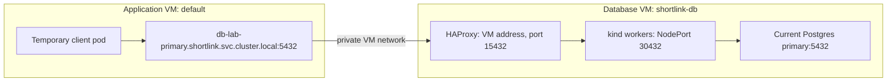

# Private database connectivity between Colima VMs

[Database lab](database-ha-lab.md) · [Migration plan](ha-migration.md)
· [Recorded verification](experiments/database-connectivity.md)

**Status:** a temporary client in the existing application cluster can securely
read and write disposable rows in the dedicated database tier. Fastify still
uses its original Postgres. Existing links have not been replicated or moved.

## Network path

Both existing Colima VMs use Lima's `user-v2` network. We verified their private
addresses as `192.168.5.1` (application) and `192.168.5.3` (database). This network
supports VM-to-VM traffic; the Kubernetes pod and Service networks remain
independent. Neither VM needed a restart.
[Lima networking](https://lima-vm.io/docs/config/network/user-v2/).



The application-side `db-lab-primary` is a **Service without a selector**. Its
manually managed EndpointSlice points at the database VM's private address and
port 15432. It is an alias for an external dependency; it does not select or own
a database pod in the application cluster. The VM address is resolved during setup and applied to Kubernetes; it is not
a hardcoded address in the checked-in manifest. [Kubernetes Services without selectors](https://kubernetes.io/docs/concepts/services-networking/service/#services-without-selectors).

The database VM's Docker bridge container publishes port 15432 to its own port
5432. HAProxy can reach the kind worker containers on that VM's Docker `kind`
network. It forwards each new connection to a worker's NodePort 30432. Kubernetes
then routes it to the primary selected by CloudNativePG. Three worker backends
avoid pinning the bridge to one worker, but worker-failure behavior on this path
has not been qualified.

The additional `shortlink-lab-external` Service is declared in the CloudNativePG
Cluster's `managed.services.additional`, with `selectorType: rw`. The operator
maintains its selector. The original internal `shortlink-lab-rw` Service remains
available for replication. A role change updates routing for new connections;
it does not transfer existing TCP sessions to another Postgres process.
[CloudNativePG Service management](https://github.com/cloudnative-pg/cloudnative-pg/blob/v1.30.1/docs/src/service_management.md).

This path uses neither a Mac database listener nor `kubectl port-forward`.
The Mac still hosts the virtual network, and its failure affects both VMs.
Traefik continues handling application HTTP traffic; database traffic uses TCP.

## TLS and authentication

TLS runs all the way from the client to Postgres. HAProxy passes bytes through;
it holds no database credentials or TLS private keys. CloudNativePG issues the
server certificate with the additional name
`db-lab-primary.shortlink.svc.cluster.local`. The probe verifies both the CA and
the hostname and authenticates as the lab's nonsuperuser `shortlink_lab` owner.
Plaintext TCP sessions for that role/database are rejected by `pg_hba` rules.
Existing local operator checks and TLS replication remain operational.
[CloudNativePG certificates](https://github.com/cloudnative-pg/cloudnative-pg/blob/v1.30.1/docs/src/certificates.md).

The bridge binds only the database VM's private address, and its source-address
allowlist accepts the application VM. Docker/pod egress is translated to that VM
address, as confirmed in bridge logs. This is a VM-level boundary: it does not
identify individual pods or restrict which application-VM workloads possess
credentials. Other trusted VMs share the virtual network; this is not an
untrusted-network isolation or NetworkPolicy test.

For verification, only the lab app username, password, database name and public
CA certificate are copied into a uniquely named temporary Secret in the source
cluster. The CA private key is never copied. The client has no Kubernetes API
token. Its Pod, ConfigMap and Secret are deleted afterward. Credentials are not
written to Git, command arguments, reports or local manifest files. This is a
probe credential transfer, not a production credential-rotation mechanism.

## Commands and lifecycle

Run from the repository root with both profiles already running:

```sh
pnpm db:lab:connect
pnpm test:db-connectivity
```

[Setup](../scripts/db-lab-connect.mjs) resolves
`lima-colima-shortlink-db.internal` from the application VM, discovers the source
VM address, applies the database and client Services, and configures a
digest-pinned bridge. It uses explicit Docker and Kubernetes contexts throughout.
The database VM has no Mac directory mounts: `docker cp` transfers the generated,
non-secret HAProxy configuration through the Docker API.

Setup reuses the existing bridge if its configuration hash matches. If addresses
or configuration change, setup replaces that stateless bridge, which interrupts
its existing database sessions. Do not use that replacement procedure as a
zero-downtime endpoint upgrade after live application cutover.

VM addresses are discovered, not permanently reserved. Rerun setup and the check
after address changes or infrastructure recreation. An EndpointSlice marked
ready here is static configuration, not an ongoing database-health observation.
There is no controller automatically refreshing VM addresses or the source
allowlist. Do not assume the alias remains usable through arbitrary VM changes.

The [integration test](../scripts/test-db-connectivity.mjs) runs an isolated
[Node/pg probe](../scripts/db-connectivity-probe.cjs) inside the existing
application cluster. It checks:

- Plaintext rejection, wrong-hostname rejection, untrusted-CA rejection and
  wrong-password rejection, each with its expected error code.
- Verified TLS to the current primary as the expected nonsuperuser, retaining
  the required one-standby synchronous write policy.
- A disposable INSERT followed by reading its exact token back, plus eventual
  visibility of that token on both standbys.
- Application-VM source address in bridge logs, unchanged Fastify Deployment
  specification, healthy sampled API/UI responses and temporary resource cleanup.

The wrong-hostname fixture maps an incorrect hostname to the same application
Service IP using the probe Pod's `hostAliases`. It therefore tests certificate
identity rather than failing because DNS cannot resolve the name.

Reports are private, ignored artifacts under
`.kind/db-cluster/connectivity-setup/<timestamp>/` and
`.kind/db-cluster/connectivity-checks/<timestamp>/`. SIGINT/SIGTERM during the
probe wait triggers cleanup. After a forced termination, inspect leftovers:

```sh
kubectl --kubeconfig .kind/kubeconfig --context kind-shortlink -n shortlink \
  get pod,configmap,secret -l shortlink.dev/connectivity-run
```

Delete only the resources belonging to the interrupted run, using its run UUID
in `-l shortlink.dev/connectivity-run=<UUID>`. Fixture rows remain in the
lab's `replication_probe` table; the test never creates a table in the old database.

## Scope and next checkpoint

The bridge is a single process in one database VM, and the new tier has one
control-plane node. This connection path does not establish end-to-end HA,
zero-error failover or the application's throughput/latency budget. The bridge
also has its own limits: 0.25 CPU, 64 MiB, 256 connections and 60-second client/server
idle timeouts. These are initial lab settings, not measured capacity targets. The original
source maintenance allowance remains unused.

For Raspberry Pi or cloud hardware, replace Lima address discovery and the
kind-specific Docker bridge with the destination's private database endpoint.
The client Service name, certificate validation and application-facing SQL
contract can remain the same after verification in the new environment.

The next increment is to finalize source-to-destination replication, inventory
objects excluded from that replication method, and prepare the source restart
requirements. The existing source database remains the only application writer.
