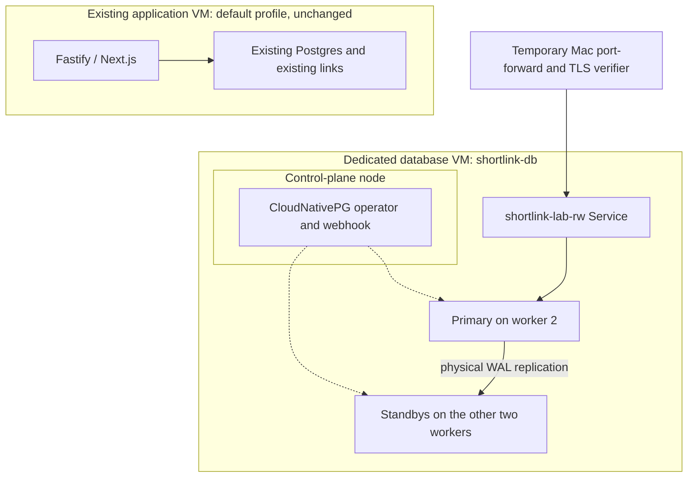

# CloudNativePG database lab

[Project overview](../README.md) · [Migration exercise](ha-migration.md)

**Status:** a disposable database tier is deployed and its healthy replication
path is verified. The live application still uses its original Postgres in the
existing `shortlink` kind cluster. No existing links have been copied into the
lab, and no source writer or traffic endpoint has moved.

The [bootstrap results](experiments/cloudnativepg-bootstrap.md) include the
failed six-GiB host-capacity check and the user-approved four-GiB repeat. They
are not evidence of failover safety, migration capacity or a throughput ceiling.

## Topology and versions

| Boundary                              | Database lab                                      |
| :------------------------------------ | :------------------------------------------------ |
| Colima profile / Docker context       | `shortlink-db` / `colima-shortlink-db`            |
| VM allocation                         | 4 CPUs, 4 GiB RAM, 40 GiB data disk               |
| kind cluster / Kubernetes context     | `shortlink-db` / `kind-shortlink-db`              |
| Private kubeconfig                    | `.kind/db-cluster/kubeconfig`                     |
| Kubernetes                            | One control plane and three workers, v1.36.4      |
| CloudNativePG                         | 1.30.1, operator namespace `cnpg-system`          |
| Postgres                              | 18.7, three instances in namespace `database-lab` |
| Postgres group / application database | `shortlink-lab` / `shortlink_lab`                 |
| Storage                               | One five-GiB node-local PVC per instance          |

All image references include registry digests in
[`versions.json`](../deploy/db-lab/versions.json),
[`kind.yaml`](../deploy/db-lab/kind.yaml) and
[`cluster.yaml`](../deploy/db-lab/cluster.yaml). The upstream operator manifest is
pinned by release URL and SHA-256, downloaded into ignored `.kind/`, then patched
locally. Its large CRDs are not copied into the repository.

The source cluster remains on Kubernetes 1.37.0 and Postgres 18.6. We chose
Kubernetes 1.36.4 for the new database cluster because CloudNativePG 1.30 lists
1.36 as supported; 1.37 is listed as tested but unsupported in the consulted
support matrix. Using different cluster versions does not change the Postgres
wire protocol. The new database's patch version does not upgrade the source.



Worker numbers in the diagram reflect the recorded initial placement, not a
permanent primary assignment. Required pod anti-affinity and a worker label
ensure separate database workers. The operator runs on the control-plane node
so losing a database worker does not also remove the manager. Losing that single
control plane is outside this lab's HA scope. All database nodes still share one
VM and physical disk.

## Commands and target selection

```sh
pnpm db:lab:up
pnpm db:lab:check
```

The [bootstrap script](../scripts/db-lab-up.sh) creates the profile if absent,
otherwise requires it to be running with the expected allocation. It does not
resize existing profiles or automatically recreate a cluster. Host memory
pressure must be normal before expansion; the script checks again before
installing the operator and creating its Postgres resource.

Docker context and kubeconfig/context arguments are explicit. `--activate=false`
prevents Colima from activating the new profile over the source. The new VM has
no host-directory mounts and no built-in K3s installation. The source remains
in the `default` profile; its VM, cluster, manifests and volume are not changed.

Inspect the lab without changing global contexts:

```sh
colima list
kubectl --kubeconfig .kind/db-cluster/kubeconfig --context kind-shortlink-db get nodes -o wide
kubectl --kubeconfig .kind/db-cluster/kubeconfig --context kind-shortlink-db -n database-lab get clusters,pods,services,pvc -o wide
kubectl --kubeconfig .kind/db-cluster/kubeconfig --context kind-shortlink-db -n cnpg-system logs deployment/cnpg-controller-manager
```

`kind: Cluster` in the CloudNativePG manifest means a group of Postgres
instances. It does not create a further Kubernetes cluster.

## Write policy and resources

The selected policy is explicit:

```yaml
postgresql:
  synchronous:
    method: any
    number: 1
    dataDurability: required
  parameters:
    synchronous_commit: "on"
```

A commit waits for WAL to be durably flushed by at least one eligible standby.
It does not wait for every standby to apply the transaction. Reads of a standby
can therefore lag an acknowledged write; our future application should continue
using the primary initially. The verifier separately waits for both standbys to
replay a captured WAL position and find the inserted probe row.

If neither standby can confirm a commit, this policy can block writes. The lab
has not yet demonstrated the no-standby failure case or qualified automatic
promotion after an unexpected failure.
CloudNativePG's separate `failoverQuorum` option remains at its observed default
`false`. Synchronous acknowledgment is not, by itself, a proof of safe promotion
under every partition or a blanket zero-data-loss guarantee.

Each database instance requests and limits 500m CPU and 512 MiB memory, with
64 MiB shared buffers and a maximum of 100 connections. The operator requests
100m CPU / 100 MiB memory and is limited to 500m CPU / 200 MiB memory. These are
small lab settings, not a production sizing prescription. Local PVC requests do
not enforce independent disk quotas. WAL retention is bounded at one GiB per
replication slot; a sufficiently lagging replica can need reseeding.

## Operator permissions and networking

The operator installation adds CRDs, webhooks and Kubernetes RBAC to the new
database cluster. Its manager can manage database Pods, PVCs, Services, Secrets,
Jobs, roles and related resources, read Nodes and execute into Pods. The patched
`WATCH_NAMESPACE=database-lab` limits what it watches; it is not a reduction of
the upstream ClusterRole's authorization. That ServiceAccount has no access to
the application's separate Kubernetes API merely because both VMs share a Mac.

The database primary Service is `shortlink-lab-rw`; `shortlink-lab-ro` targets
standbys and `shortlink-lab-r` targets ready instances. All are ClusterIP Services.
The new Kubernetes API is forwarded to loopback port 16443. Pod and Service
networks are 10.246.0.0/16 and 10.98.0.0/16, separate from the source cluster's.

The checker opens a temporary loopback-only port-forward to the primary Service,
uses the generated nonsuperuser application role and verifies TLS against the
operator-generated CA and the Service's certificate hostname. It closes the
port-forward and client afterward. It reads only the new lab's app password and
CA into memory and does not save Secret objects or decoded credentials.

**This verifies Mac-to-database connectivity, not application-VM-to-database-VM
routing.** No permanent database port, public database endpoint or application
connection change is introduced. Cross-VM routing, endpoint naming and TLS
configuration remain a separate migration increment.

## What the check proves

The [verifier](../scripts/db-lab-check.mjs) checks pinned versions, readiness,
three-worker placement and three distinct bound PVCs. Through verified TLS it
inserts a unique row in `replication_probe` as the application role. It checks
actual synchronous commit settings, two streaming standby connections, and the
row plus replay position on each standby. Each run retains one more disposable
probe row and records non-secret evidence under:

```text
.kind/db-cluster/checks/<UTC timestamp>/result.json
```

A passing check also requires normal host memory pressure and at least 20%
guest available memory. It does not inject sustained traffic, stop a primary,
prove read-after-write behavior through the live app, or test request retries.

A [private cross-VM endpoint](database-connectivity.md) is now available and
verified from a temporary application-cluster client. The live Fastify service
still uses its original database.

No database backups, WAL archive, source replication stream, Grafana integration
or off-host durability policy is configured for this disposable tier yet. The
original source backup remains on the Mac. Do not use this lab as the sole home
of real links before those migration and recovery checkpoints pass.

## Planned primary switchover

```sh
pnpm test:db-switchover
```

Run this only against the disposable lab, with no concurrent database maintenance.
It selects a healthy standby and asks the pinned CloudNativePG CLI to promote it.
The new primary remains primary afterward; the test does not automatically switch
back. It never stops workers or changes replication/shutdown settings.

The [coordinator](../scripts/test-db-switchover.mjs) creates one temporary Pod and
ConfigMap, using an existing digest-pinned API image only as a Node/pg runtime.
The application server and its image entrypoint are not started. The Pod has a
128 MiB memory limit, no Kubernetes API token, a read-only filesystem, generated
application-role credentials via Secret references, and only the public CA
certificate mounted from the CA Secret. It connects with verified TLS to
`shortlink-lab-rw.database-lab.svc` through the actual Service network.

Do not replace this with a `port-forward service/...` when measuring endpoint
handoff: that tunnel selects a pod and does not follow later primary changes.

The [probe](../scripts/db-lab-probe.cjs) retains separate writer and reader
connections. Each loop performs one operation, then waits until roughly 100 ms
has elapsed before its next attempt. It runs for 60 seconds, with at least ten
seconds of error-free baseline before promotion. This is closed-loop pacing,
up to about ten writes and ten reads per second, not a fixed-arrival-rate or
throughput-ceiling benchmark. Connect and query waits are bounded; stalled
operations reduce how many attempts start.

A failed connection is replaced on the next attempt. No INSERT is automatically
retried. Each write has a unique token, and its outcome is classified as:

- **Acknowledged:** PostgreSQL returned a successful INSERT response.
- **Not sent:** connection establishment failed before the INSERT was attempted.
- **Ambiguous:** the query was attempted but no successful response was received.
  After recovery, look up that token to determine whether it committed.

The reader also checks that its connection is on a primary; it must not quietly
continue reading the former primary after it becomes a standby. These behaviors
belong to the test client. They do not add public-API creation idempotency or
change Fastify's existing database error handling.

The coordinator records roles, Cluster status, primary-Service EndpointSlices,
source API/UI smoke checks and host memory pressure. EndpointSlices can be empty
during the transition. Records are sampled observations, not atomic snapshots
of all servers. Durations between successful client operations use the probe's
own monotonic clock and include normal pacing. They are not exact measurements
of the period when PostgreSQL itself had no primary.

The acceptance criterion is a data-preserving, recoverable planned handoff:
all acknowledged writes remain on the new primary, unknown outcomes are
accounted for, the former primary returns as a standby, Service routing reaches
the new primary, and both client loops resume successful operations. Sampled
source health must remain good and host pressure normal. **Connection failures
are measured, not forbidden by this test. A passing result is not a zero-error
availability SLO.** Read the [recorded trial](experiments/database-switchover.md)
for the observed interruption and the [recovery-gap investigation](experiments/database-switchover-recovery.md)
for its timing breakdown.

Evidence is retained privately in `.kind/db-cluster/switchovers/<timestamp>/`:
`probe.ndjson`, `timeline.json` and `result.json`. The temporary Pod and ConfigMap
are deleted using their run-specific label. Test rows are retained in the lab;
credentials and Secret contents are not exported. If interrupted, inspect the
actual primary before doing anything else: a completed promotion is not undone
by stopping the test. Preserve failed trials rather than tuning settings or
silently switching back to make a result pass.

## References

- [CloudNativePG supported releases](https://cloudnative-pg.io/docs/current/supported_releases/).
- [CloudNativePG installation](https://cloudnative-pg.io/docs/current/installation_upgrade/).
- [CloudNativePG replication](https://cloudnative-pg.io/docs/current/replication/).
- [Operator configuration](https://cloudnative-pg.io/docs/current/operator_conf/).
- [kind v0.33.0 node image releases](https://github.com/kubernetes-sigs/kind/releases/tag/v0.33.0).
