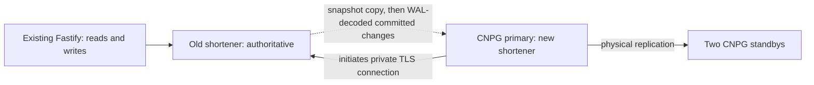

# Initial copy and live replication

[Migration plan](ha-migration.md) · [Preparation](database-replication.md) ·
[Recorded results](experiments/initial-replication.md)

**Status: initial copy verified on November 15, 2026; logical replication remains
running.** Fastify still reads and writes the old database. No writer cutover or
application pool change has happened.

## Databases and connection direction

The old `shortener` database publishes `public.links` and
`drizzle.__drizzle_migrations` through `shortlink_migration`. The new database
is also named `shortener`, owned by the nonsuperuser `shortlink_lab` role inside
the existing CloudNativePG group `shortlink-lab`. The original `shortlink_lab`
database and its disposable probes are preserved.

The user chose a separate database because source and lab locales differ. The
new database preserves source UTF8 encoding, libc provider, `en_US.utf8` sorting
and character rules, and collation version 2.41. The source schema is restored
without copying source ownership or ACLs. Schema migrations remain frozen.



Initial synchronization reads a consistent source snapshot using COPY. Ongoing
replication decodes committed changes from WAL rather than polling the tables.
The subscriber connects to
`migration-source.database-lab.svc.cluster.local:5432`, through the private
cross-VM publisher bridge. There is no replication port-forward through the Mac.
See [source networking and credentials](source-maintenance.md).

Native SQL subscription `shortlink_migration_sub` references Secret-backed CA
and password files materialized on all three CNPG instances. It uses
`sslmode=verify-full`; neither SQL nor reports contain an inline password. The
subscription is asynchronous relative to old application writes. Required
synchronous standby confirmation inside CNPG does not change that relationship.

## Commands and repeat protection

```sh
pnpm db:replication:start       # One-time real database/schema/copy/stream creation
pnpm db:replication:status      # Read-only stream, table-sync and error inspection
pnpm test:replication:live      # Read-only schema/contents/standby comparisons
pnpm test:replication:watch     # Isolated monitor success/failure Jobs; then cleanup
```

The start command has already run. It refuses an existing destination database
or pre-existing source replication objects; it does not truncate, drop or recopy
real data automatically. After a partial failure, inspect its report and actual
resources instead of replaying preparation or maintenance commands. The old
source remains authoritative. Start leaves the real subscription running even
when a later verification fails so recovery is an explicit decision.

[Coordinator](../scripts/live-replication.mjs) ·
[Shared helpers](../scripts/lib/live-replication.mjs) ·
[Database choice](../deploy/migration/live-copy.json) ·
[Publication](../deploy/migration/source-publication.sql) ·
[Subscription](../deploy/migration/destination-subscription.sql).

## What verification means

The copy compares table columns, constraints and indexes, complete-row SHA-256
digests and counts for links and migration history, and the same bounded contents
on both physical standbys. Eight labelled links are created through the existing
REST and GraphQL entrypoints before, during and after initial synchronization;
each immediately redirects correctly through the old application.

To make overlap observable on this small database, the coordinator briefly holds
a SHARE lock on the destination links table, observes its table-sync state `d`,
creates source links, then releases the lock and verifies catch-up to `r`. The
lock never targets the source. Its session has a 30-second idle transaction
limit and is released in cleanup. This technique first passed against disposable
fixtures. It demonstrates writes during synchronization, not sustained k6 load.

Content checks record source maximum IDs, then compare source, destination and
source again through those boundaries. Higher-ID appends can continue. A stable
matching prefix is useful evidence for this append-only app; it is not a
cross-server atomic snapshot or proof that the source can no longer write.
Sequence IDs can be allocated before commit, so later commits can still change
a prefix. Cutover needs an independently verified final barrier after fencing.
The in-memory aggregate hashing is sized for this lab, not arbitrary huge tables.

Destination sequences are inspected but intentionally not advanced. The copied
IDs do not advance their generators. **Do not enable destination application
writes until sequence correction and the writer handoff are complete.** This is
a policy boundary; the database is writable by its owner and replication worker,
not technically a read-only database.

## Source WAL and disk protection

A source-namespace CronJob `migration-replication-watch` runs every minute with
the dedicated replication login, verified TLS, no Kubernetes API token, a
read-only root filesystem and a read-only source PVC mount for filesystem
headroom. It runs [read-only SQL](../deploy/migration/replication-watch.sql) via
[the watcher script](../scripts/watch-replication.sh).

| Observation                                         | Response encoded in the check             |
| :-------------------------------------------------- | :---------------------------------------- |
| Retained slot WAL at least 64 MiB, or slot inactive | Warning in JSON log                       |
| Retained slot WAL at least 96 MiB                   | Failed Job; investigate retention/re-copy |
| Required slot missing, invalidated or lost          | Failed Job                                |
| Slot inactive for more than two minutes             | Failed Job                                |
| Source filesystem free space below 512 MiB          | Failed Job                                |

The source's 128 MiB retention setting is checkpoint-enforced, not a hard disk
cap. These are initial operating thresholds, not a measured maximum replication
outage. Check filesystem headroom and actual WAL generation under the intended
workload. Failed Jobs and logs are the implemented signal: there is no automatic
notification, Grafana integration, slot deletion, recovery or emergency stop.
A failed check does not itself stop replication. An invalidated slot can require
rebuilding the copy while preserving the source as authority.

```sh
kubectl --kubeconfig .kind/kubeconfig --context kind-shortlink -n shortlink get cronjob migration-replication-watch
kubectl --kubeconfig .kind/kubeconfig --context kind-shortlink -n shortlink get jobs -l shortlink.dev/exercise=live-replication
# Substitute a Job name from the preceding output.
kubectl --kubeconfig .kind/kubeconfig --context kind-shortlink -n shortlink logs job/JOB_NAME
```

The monitor test uses separate temporary ConfigMaps and Jobs: the healthy real
slot must pass; a fabricated missing-slot name must fail. It never changes the
real slot or the persistent monitor, and removes its fixtures afterward.

## Next checkpoint: rehearse writer handoff

[Runtime maintenance control](runtime-maintenance.md) now implements the creation
gate and per-pod observations, tested without a live rollout. The user is
considering explicit creation rejection during the transfer instead of queued
HTTP requests; no live cutover or final window budget is agreed.

Use disposable publisher/subscriber data and steady test writes to rehearse:
hold new creation requests with bounded waiting, finish in-flight writes, fence
all old writers, establish and verify a final published-data barrier, correct
sequences, stop the migration apply worker, and switch client pools. Confirm all
serving redirect readers use the new primary before releasing new creations.
Otherwise a newly created destination link could hit an old reader and get 404.
Existing source reads can continue until final catch-up; during the read handoff,
both databases contain the same finalized data and application writes are held.

This is increased creation latency if waiting requests succeed within the agreed
limit; timeouts or rejected requests are partial unavailability. Measure the
handoff before choosing a creation latency/waiting budget. The runtime gate now
provides multi-replica creation admission control; the startup pool and graceful shutdown still do not implement hot pool handoff or
idempotency for ambiguous write outcomes. The final mechanism
still needs design and tests; a DNS change does not retarget existing connections.

Reading the destination before write cutover is possible, but asynchronous lag
can return 404 for a newly acknowledged source link. For our immutable links,
source fallback on a destination miss is one possible intermediate policy; it
requires separate read/write pools and keeps a source dependency. Warming Redis
alone does not guarantee read-after-write consistency.

A durable external queue could accept creation work while workers are paused,
but acceptance is not completed link creation. Returning 202 would change the
API/UI contract; waiting for completion still adds latency. Consumers need
idempotent database effects and writer fencing. Neither the current pool queue
nor Postgres WAL is a durable inbox for uncommitted HTTP creation requests. A
queue is an architectural option, not an implemented migration prerequisite.

Destination backup/recovery qualification, an explicit creation waiting limit,
old-writer fencing, safe retries and application-pool coordination are still
required before live cutover. Once the new tier accepts writes, switching back
to the stale source is not a safe rollback. No steady-load latency target or
subscriber failover guarantee is established by this copy.

Private reports, cohort mappings and schema dumps live under
`.kind/db-cluster/live-replication-<mode>/<timestamp>/`; monitor tests live under
`.kind/db-cluster/replication-watch-tests/`. Keep these local artifacts out of
public CI uploads. The recorded source backup remains on the Mac; the new tier
has not yet qualified its own backup and restore path.
