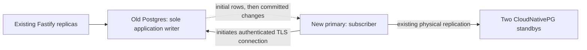

# Logical replication preparation

[Migration plan](ha-migration.md) · [Database connectivity](database-connectivity.md)
· [Recorded rehearsal](experiments/replication-preparation.md)

**Status:** source/destination inventory and a disposable cross-VM logical
replication rehearsal pass. The source settings and publication/subscription SQL
define the real-data stream. Source restart and credentials were completed by the
[source maintenance bundle](source-maintenance.md); no publication, logical slot,
subscription or real-data copy is started by the preparation commands.

## Approach and connection direction

Use PostgreSQL's built-in logical replication, with the original `shortener`
database as publisher and the new `shortlink_lab` primary as subscriber. The old
application remains the only writer until an explicitly coordinated cutover.
The subscriber first copies the published tables and then applies subsequent
committed changes. One subscription keeps transactions spanning the two tables
in the same stream. [PostgreSQL logical replication](https://www.postgresql.org/docs/18/logical-replication.html).



This is one-way migration replication. The physical replication already inside
CloudNativePG serves a different purpose: maintaining its standbys. We do not
introduce application dual writes or synchronous commits back to the old source.
The migration stream is asynchronous, so a link acknowledged by the old source
need not be visible on the destination immediately. Keep serving from the old
source until the cutover protocol establishes a final replication barrier.

Logical replication fits this exercise because its table-oriented protocol can
work across machines and PostgreSQL versions. Use text transfer (`binary=false`)
and verify the actual destination platform; this rehearsal used ARM64 Postgres
18.6 to 18.7, not Raspberry Pi hardware.

The subscriber opens the network connection **back to the publisher**. Our
existing application-to-new-database endpoint does not establish that reverse
path. Before live replication, add a separate private publisher endpoint in the
application VM, narrowly reachable from the database VM, with verified TLS and
replication authentication. The fixture test uses a temporary publisher bound to
application VM port 25432; it does not expose the live source through that port.

## Inventory and excluded objects

The live source contains these tables and dependent sequences:

| Object                                 | Migration handling                                                                                            |
| :------------------------------------- | :------------------------------------------------------------------------------------------------------------ |
| `public.links`                         | Publish all rows/columns, preserving IDs, codes, destinations and timestamps.                                 |
| `drizzle.__drizzle_migrations`         | Publish existing history; freeze schema migrations during this first exercise.                                |
| `public.links_id_seq`                  | Explicitly synchronize before destination application writes.                                                 |
| `drizzle.__drizzle_migrations_id_seq`  | Explicitly synchronize before running destination migrations.                                                 |
| Schema, indexes, constraints, defaults | Copy with a schema-only dump before starting the subscription.                                                |
| Owners and grants                      | Map source-owned objects to destination `shortlink_lab`; do not clone the source bootstrap role's privileges. |

Both tables are permanent and have primary keys with default replica identity,
which identifies rows for UPDATE and DELETE. There are no user functions,
triggers, row-security policies, large objects, foreign tables or non-default
extensions in the recorded inventory. The preparation command rejects a changed
table set or unsupported inventoried object rather than silently omitting it.
It is tailored to this project's current schema, not a general database migration
analyzer.

Logical replication does not carry schema changes or sequence state. A
successfully copied identity column does not mean its sequence has advanced.
At cutover, first finish/fence source writes and establish destination catch-up;
then choose safe next sequence values, accounting for sequence increment,
limits and any previously allocated values. The fixture's ascending unit-step
sequences can be corrected from copied maxima; that is not a general solution
for cached, descending or externally reserved sequence values.
[Replication restrictions](https://www.postgresql.org/docs/18/logical-replication-restrictions.html).

## Preparation command and staged files

```sh
pnpm db:replication:prepare
pnpm test:replication
```

The [preparation command](../scripts/prepare-replication.mjs) runs the read-only
[catalog inventory](../deploy/migration/inventory.sql), checks the explicit table
list and replica identities, records source/destination worker settings, exports
schema without ownership/ACLs, and asks Kubernetes to validate the settings patch
with `--dry-run=server`. It does not apply the patch. Private evidence lives under
`.kind/db-cluster/replication-preparation/<timestamp>/`.

The original inventory found `wal_level=replica` and TLS off. After
[source maintenance](source-maintenance.md), the source has logical WAL, TLS,
ten replication slots, ten WAL senders and no live replication objects. The destination has four logical workers,
ten replication origins and 32 total workers, enough for this tested one-stream,
two-table rehearsal. That setting change required the completed source restart; the current
single-instance Postgres Deployment uses `Recreate`.
[Logical replication settings](https://www.postgresql.org/docs/18/logical-replication-config.html).

Review these staged files:

- [Source settings patch](../deploy/migration/source-settings.patch.yaml): enables
  logical WAL and retains ten slots/senders. It was applied inside the completed maintenance window. Changing its Pod
  template can restart the single source instance; ordinary startup preserves
  the completed configuration using the maintenance marker.
- [Source role SQL](../deploy/migration/source-role.sql) provisions the separate
  nonsuperuser login and SELECT grants during source maintenance. The independent
  [publication SQL](../deploy/migration/source-publication.sql) publishes
  INSERT/UPDATE/DELETE/TRUNCATE only when the later real-data stream starts.
- [Destination subscription SQL](../deploy/migration/destination-subscription.sql):
  starts initial copy and text-based streaming. `synchronous_commit=on` is explicit
  for the subscriber, retaining its required standby-confirmation policy. It does
  not make the old source wait for this subscriber.

The REPLICATION attribute is powerful. Restricting SELECT grants and explicitly
listing publication tables does not make it a publication-scoped security role;
Postgres has no separate publication ACL. Do not reuse an application login.
[Replication security](https://www.postgresql.org/docs/18/logical-replication-security.html).

The patch's **128 MB `max_slot_wal_keep_size` is the initial source limit**,
reviewed against the [maintenance rehearsal's WAL samples](experiments/source-maintenance.md). It replaces unlimited slot retention, but
is neither a measured outage allowance nor a hard disk-size cap: enforcement is
checkpoint-dependent and exceeding it can invalidate the slot, requiring a new
copy. Before creating a live migration slot, monitor actual WAL generation/storage
and apply the runbook's investigation and stop/re-copy thresholds.
A tiny successful fixture does not qualify that retention budget.
[Slot retention settings](https://www.postgresql.org/docs/18/runtime-config-replication.html#RUNTIME-CONFIG-REPLICATION-SENDER).

## Disposable rehearsal

The [rehearsal](../scripts/rehearse-replication.mjs) uses a digest-pinned Postgres
18.6 Docker container in the application VM, with its own labeled volume,
generated credentials, temporary TLS certificate, 256 MiB memory and 0.5 CPU
limits. Publisher arguments come from the server-dry-run settings patch; the
staged publication/subscription SQL is executed with fixture identifiers. Only
the real schema is read from the source; every inserted row is a
fixture using `example.test` destinations.

The subscriber is a uniquely named temporary database on the actual CloudNativePG
primary, with tables owned by `shortlink_lab`. It does not alter the existing
`shortlink_lab` database's tables. The publisher login has REPLICATION and SELECT,
but no superuser or INSERT privilege. Network connections use `sslmode=verify-full`
and the subscriber explicitly enables synchronous commit.

The test verifies:

1. Initial snapshot copy of both tables, comparing complete-row hashes and counts.
2. Ongoing committed INSERT, UPDATE and DELETE, plus migration-history changes.
   A rolled-back insert must be absent from the complete-row comparison.
3. Subscription disablement and actual publisher disconnection, a new source
   fixture write absent from the paused subscriber, retained slot WAL, and exact
   catch-up after re-enabling replication.
4. Both target sequences remain unadvanced despite copied IDs. After dropping
   the fixture subscription, correcting them permits new target IDs above both
   copied maxima. This simulates only the sequence step, not live writer fencing.
5. Publisher slot removal, fixture database/container/volume cleanup, removal of
   temporary trust/password/key files, unchanged live deployment specifications
   and source replication state, and sampled API/UI health.

The temporary subscriber password file and trust certificate use the primary
Pod's private writable `/controller/run` directory; its root filesystem is
read-only. The subscription references the password-file path, keeping the
password out of SQL connection strings, command arguments and reports. Its files
are deliberately temporary and present only on that primary. A live subscription
will need persistent credential/trust material available on every eligible
primary; this fixture does **not** qualify subscriber failover.

Reports contain fixture hashes, slot status and sequence observations under
`.kind/db-cluster/replication-rehearsals/<timestamp>/`. No source data rows are
exported by this exercise. Generated key/env files are removed after normal
cleanup. Forced termination may require inspecting the recorded run ID for
labeled Docker resources, its `migration_rehearsal_<suffix>` database and the
matching private runtime files; do not delete unrelated replication resources.

## Next replication checkpoint

The [source maintenance bundle](source-maintenance.md) and its
[recorded verification](experiments/source-maintenance.md) are complete. The
single maintenance allowance has been used; the application VM is six/six and
the database VM remains four/four.

Next copy the schema, create the explicit publication/subscription and verify
real rows plus a cohort created during initial synchronization. Monitor lag,
retained WAL and disk headroom from the start. The old source remains the only
application writer. Destination recovery, writer fencing, sequence correction,
idempotency and application-pool handoff remain later cutover prerequisites.
