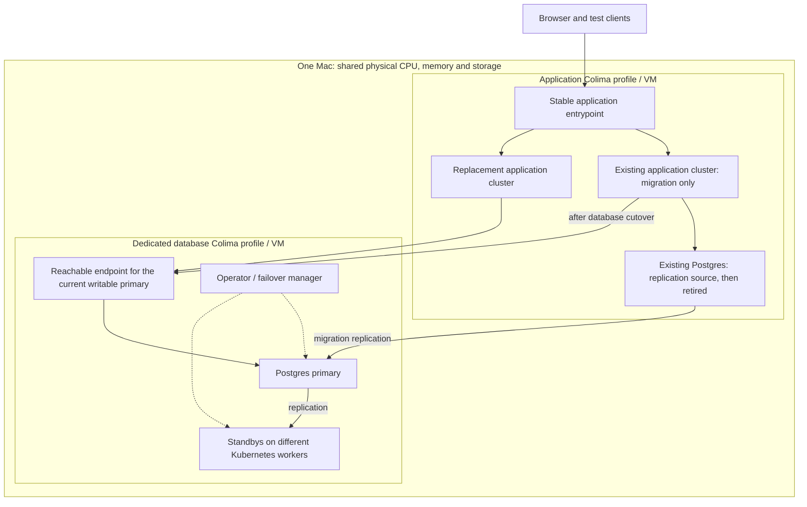

# HA and migration exercise

[Project overview](../README.md) · [Current Kubernetes setup](kubernetes.md)

**Status: in progress; initial real-data replication verified November 15, 2026.**
This document preserves the agreed direction, intended end state, learning goals
and unresolved decisions. It is not an executable runbook or evidence that HA
or a zero-downtime migration already works. Update it as each increment is
reviewed, and record measured results separately.

The [initial capacity inventory](experiments/ha-capacity-planning.md) was
completed on November 14, 2026. It proposes profile budgets and a first-phase
worker-failure topology; provisioning and source maintenance followed later.
The [backup/restore rehearsal](experiments/backup-restore.md) subsequently passed
twice; the [procedure](database-recovery.md) and command are available for reuse.
The single planned source interruption was [used on November 15](experiments/source-maintenance.md)
to resize the application VM and prepare logical replication/TLS.
The [CloudNativePG lab](database-ha-lab.md) is now provisioned with disposable
data and verified healthy synchronous replication. The user selected one required
synchronous standby. Its [bootstrap report](experiments/cloudnativepg-bootstrap.md)
records the failed six-GiB host gate and the approved four-GiB database profile;
full overlap capacity, unexpected failover and live writer handoff remain unverified.
A [planned switchover trial](experiments/database-switchover.md) subsequently
preserved all 517 acknowledged test writes and recovered client access, with
multi-second connection interruptions. Unexpected failover and zero-error
application migration remain unqualified. A [read-only recovery investigation](experiments/database-switchover-recovery.md)
subsequently separated ownership handoff, Service publication and client/write
recovery; no timing or durability settings were tuned.
[Private cross-VM connectivity](database-connectivity.md) is now implemented and
verified with a temporary client in the existing application cluster, including
TLS identity/authentication and fixture replay. Fastify still uses its old
database; writer cutover has not begun.
[Logical replication preparation](database-replication.md) now includes a live
object/settings inventory, dry-run source patch and passing disposable cross-VM
initial-copy/change-stream rehearsals. [Source maintenance](source-maintenance.md) subsequently completed: the
application VM is six CPUs/six GiB, the source has logical WAL/TLS and the reverse
endpoint is verified. The [initial copy and live stream](database-replication-live.md)
subsequently passed: 7,764 original links plus eight concurrent-copy test links
matched on the new primary and both standbys. The old source remains the only
application writer. [Runtime creation maintenance](runtime-maintenance.md) is now
deployed and verified in the [steady-load image rollout](experiments/fastify-runtime-rollout.md), with source selected. It supports explicit
creation rejection during maintenance; no final maintenance-window budget or
live handoff has been qualified. [Pool switching](database-pool-switching.md) is now deployed after fixture tests
and a passing staged-image rollout under load. The real HA application
[connection target](experiments/ha-target-preparation.md) is now staged and
validated by both Fastify replicas; source remains selected. Its full rollout
load trial failed client thresholds, including baseline errors, and is not a
clean load qualification. Live writer fencing and safe handling of ambiguous write outcomes remain
separate increments; the
source remains authoritative. The HA tier now also has a passing
[logical backup/restore qualification](experiments/ha-backup-restore.md), with
clone-only sequence preparation and no live writer change. A
[disposable handoff rehearsal](experiments/database-handoff.md) subsequently
passed at 25 redirects/s plus two creation attempts/s, with a deliberate
pre-fence failure and a measured 1.174-second successful creation-maintenance
window. Its permission-based fence requires a dedicated source application
role: the live login is the bootstrap superuser and cannot be demoted. That
role preparation, the failed operating-load qualification and final preflight
remain gates before real cutover.

## Purpose and goals

Practice moving a running service and its existing data to new infrastructure
without discarding the old environment or treating a database as disposable.
Establish an independent database tier first, then migrate application traffic.
Later, repeat the process against suitable Raspberry Pi hardware or a cloud
endpoint; hardware suitability remains a separate prerequisite.

The learning goals are to:

- Separate VM, Kubernetes-node, application-pod and database failure boundaries.
- Give the database an infrastructure lifecycle independent of the application.
- Distinguish replication for migration from replication for database failover.
- Maintain one authoritative database writer during data transfer and cutover.
- Move application traffic gradually, with observable progress and rollback.
- Verify availability and data integrity using clients, not just ready-pod counts.
- Retain a repeatable procedure and evidence for a later hardware migration.

## Current baseline

The existing deployment has one kind node, `shortlink-control-plane`, in the
`shortlink` cluster and the current Colima profile. The documented allocation is
6 CPUs / 6 GiB after source maintenance; the database profile remains at 4/4.
These budgets still need qualification under peak application-cluster overlap.
Fastify has two replicas, Next.js and Traefik one each. Postgres has one instance
and a node-local persistent volume; Redis is an ephemeral cache.

The HAProxy bridge exposes `app.localhost:8080`, `go.localhost:8080` and
`grafana.localhost:8080`, forwarding to one kind node. Database connection pools
are created per Fastify process. The application has no demonstrated database
writer handoff, creation idempotency protocol or cross-cluster deployment flow.

Existing release and test scripts target explicitly supported local or CI
contexts. Do not assume they support arbitrary new profiles and clusters.
[Delivery](delivery.md), [browser testing](browser-testing.md) and
[performance](performance.md) describe the implemented behavior.

## Intended topology and end state

Keep kind for this local exercise. Use kind for both destination clusters;
retain the existing kind cluster as the migration source. Migration to K3s is
deferred to the later hardware exercise, not a prerequisite for local HA work.
Keep workload configuration portable and isolate kind-specific provisioning,
image loading and context assumptions in deployment tooling.

Use two Colima profiles, each representing a separate VM. Keep the existing
application profile and create a dedicated database profile. The database
profile is `shortlink-db` with its own kind cluster and verified private endpoints.
The application VM is six CPUs/six GiB and database VM four/four; replacement
application-cluster capacity remains to be qualified. Existing resources must
not be renamed or recreated implicitly.

During migration there are three Kubernetes clusters across two VMs: existing
application, destination database, and replacement application. The existing
cluster still contains its original Postgres until data migration is complete.
After retirement there are two clusters: application and database, in separate
profiles. Both application generations use the shared database tier during
application traffic migration.

The destination application will have replicas of Fastify, Next.js and Traefik
spread across worker nodes. The database cluster will have a primary and
standbys with separate volumes on different workers, plus managed failover and
a primary endpoint. Exact replica counts, worker counts and control-plane
topologies must follow the resource inventory and the failure scope we choose.
A namespace alone does not provide an independent control plane or VM.

## Failure boundaries and resource limits

A node is a Kubernetes participant; a worker is a node assigned to run workloads.
For kind, nodes are containers inside a VM. Several pods can share one worker.
A control-plane node manages the cluster and can also run workloads when allowed.

| Failure or change                | What the exercise should establish                                                    |
| :------------------------------- | :------------------------------------------------------------------------------------ |
| Application pod replacement      | Healthy replicas continue serving while pods drain and routing updates.               |
| Application worker stops         | Replicas on other workers remain reachable; recovery and errors are measured.         |
| Postgres process or worker fails | A standby can safely become the sole primary; clients reconnect.                      |
| Application VM restarts          | Database VM and its data remain running; application traffic still needs its VM.      |
| Database VM stops                | Every database replica in that VM is unavailable; this topology does not tolerate it. |
| Mac or physical disk fails       | Both VMs are affected; this is outside the local HA boundary.                         |

Control-plane HA is a distinct checkpoint. One control-plane node plus several
workers does not provide control-plane redundancy. Multiple database replicas
do not by themselves provide automatic failover or safe writer selection.

Each profile has its own guest resources, kernel, container runtime and virtual
disk, but the profiles share physical hardware. vCPU allocations are not
reservations of exclusive physical cores. kind nodes may each report the VM's
capacity: summing their advertised capacity does not create more CPU or RAM.
Measure VM and Mac pressure as well as pod usage.

Budget for the peak overlap: both application clusters, old and new databases,
Kubernetes components, monitoring, replication work and recovery/rollout headroom.
Creating the database profile need not stop the existing profile if the Mac has
capacity. A shared external entrypoint is also a dependency; its failure is not
made redundant just by adding application replicas.

## Availability and data-integrity goals

One planned interruption is allowed for preparation, including resizing the
existing VM or database settings that require a restart. Prepare and rehearse
all known restart requirements before spending that interruption. Creating the
new profile is not itself a reason to stop the existing one. After preparation,
retain existing service availability while building, replicating and migrating.

The intended migration acceptance criteria are:

- Existing codes retain their exact destinations and redirect semantics: `302`,
  correct `Location`, and `Cache-Control: no-store`.
- No acknowledged link creation is lost during the planned cutover. Links
  created before, during and after migration remain usable immediately after
  successful creation, whichever application cluster receives the redirect.
- No migration-induced failed client requests or dropped scheduled k6 starts
  in a passing migration trial; account for incomplete and timed-out requests.
- Preserve the existing client-measured redirect target at the qualified
  workload: at least 99% correct redirects within 100 ms at 1,000 redirects/s
  plus 10 creations/s. Report baseline, transition and recovery separately,
  alongside the overall result. Run durations and phase windows are to be set
  in the test plan; the existing target is defined for 30-second trials.
- Detect and report any additional creation delay. A maximum creation latency
  or holding time has not been agreed and must be decided before writer cutover.

These are goals, not guarantees. A planned writer switch may briefly hold
creation requests while reads continue. Replication, a stable endpoint and
reconnection alone cannot promise that every in-flight request succeeds.
Design and test bounded holding, old-writer fencing, pool handoff and safe
handling of ambiguous write results before calling the procedure zero downtime.

For an unplanned primary failure, separately choose acceptable data loss and
recovery time. Asynchronous replication can lose acknowledged writes if the
primary fails before those changes reach a standby. Synchronous replication
changes write latency and availability when required standbys are unavailable.
The planned-cutover data-loss goal does not settle that failure policy.

## Migration increments and review checkpoints

### 1. Inventory and prepare

Read the current host/profile allocations and measure CPU, available memory,
pressure and disk use. Propose the two-profile budget and node topology before
provisioning. Inventory data, images, volumes, contexts and network endpoints.
Create a backup outside the database VM and verify restoration. A backup on the
same Mac does not protect against Mac or physical-disk loss.

Prepare any source Postgres replication settings, connectivity, credentials and
monitoring needed after the allowed restart. Keep the existing public origins
and preserve their entrypoint during later routing changes. Record the outage
and verify that the existing service and data recover before continuing.

**Checkpoint:** reviewed capacity plan, backup/restore evidence, restart plan and
explicit failure scope. No destructive recreation of the existing cluster.

### 2. Build the dedicated database environment

Create the new profile and database cluster without redirecting production-like
traffic. Choose a supported operator/failover manager and deploy a disposable
HA database first. Test placement, storage, primary selection and recovery before
using it as the migration destination. Keep application reads/writes disabled
against the destination until the appropriate migration phase.

Provide an authenticated, narrowly reachable database endpoint across VMs.
Kubernetes ClusterIP Services are not automatically reachable from another
cluster, and loopback addresses refer to the caller's own network environment.
Verify routes, port mappings, TLS and non-overlapping network ranges as required.
Use explicit Docker contexts and kubeconfig/context pairs for every operation.

**Checkpoint:** existing environment unchanged and available; destination
replication and failover behavior understood using disposable data.

### 3. Replicate existing data

Use native PostgreSQL logical replication as the source-to-destination approach,
with explicit publication tables and one subscription. The [preparation and
fixture rehearsal](database-replication.md) validate the approach on our current
versions; the [real-data stream](database-replication-live.md) is now active.
Physical replication within the new HA
tier is a separate mechanism from this initial migration stream.

Keep the existing database as the only application writer. Copy the schema and
initial data, stream subsequent changes, and monitor synchronization, retained
WAL, disk use and source impact. Logical replication does not automatically copy
DDL, sequences, roles or all database objects: inventory and handle these
explicitly, including the `links.id` identity sequence and migration history.
Freeze schema changes during the first migration exercise.

**Checkpoint:** existing application still uses its old database; destination
has completed the initial copy, is keeping up, and passes data comparisons.
Row counts alone are insufficient: verify code/destination mappings and a
recorded cohort of writes made during synchronization.

### 4. Move the existing application to the new database tier

First rehearse with disposable data. Coordinate every writer: hold new creations
at a bounded boundary, finish in-flight writes, fence the old writer, establish a
final replication position and verify destination application of those changes.
Synchronize required objects/sequences, complete the migration subscription
handoff, enable the destination as sole writer, move application pools and
release held creations. Preserve a defined redirect read path throughout.

A changed hostname or primary endpoint does not move existing pooled connections.
Unknown commit outcomes must not trigger blind creation retries; decide whether
idempotency is needed and how it works through both REST and GraphQL paths.
Prevent a restored old primary or migration stream from reintroducing writes
against the new authoritative data.

**Checkpoint:** the existing application alone runs successfully against the new
HA tier, pre-existing and concurrent links are intact, and failure/reconnection
behavior has been measured. Do not silently treat a short write outage as a
passing zero-downtime handoff.

### 5. Migrate application traffic

Build the replacement application cluster in the application profile. Deploy the
same verified application versions first; avoid combining infrastructure
migration with a feature or schema change. Use the established database tier
for all application reads and writes. Replica reads are deferred so replication
lag cannot hide a newly created link.

Configure the stable entrypoint to reach both application clusters and preserve
connections during updates. Gradually shift traffic, for example 1%, 10%, 50%,
then 100%, with observation and rollback gates. These percentages are a proposed
sequence, not an existing routing capability. The current bridge is TCP-only:
connection weights do not guarantee per-request percentages on persistent
connections. Select and verify the actual traffic-control method.

Redis is disposable and does not need data migration. Allow cold caches to warm
under controlled load and measure database fallback pressure. Application
replicas on different workers require explicit placement rules, not just higher
replica counts.

**Checkpoint:** k6 and Playwright succeed on both generations during each stage;
all writes still use the same authoritative database. Test worker failure as a
separate fault experiment rather than combining it with the first cutover.

### 6. Verify independence and retire old resources

At 100% destination traffic, confirm the old application has drained and no
clients depend on its endpoints. During a controlled trial, stop the old cluster
and verify service, data and monitoring remain available. Retain backups and a
reviewed retention window before deleting the old database, volumes or cluster.
Record the final image digests, endpoints, profile allocations, topology and
remaining single points of failure.

## Rollback rules

Before database cutover, abandon/rebuild the destination while the old database
remains authoritative. Do not remove replication resources without considering
retained WAL and source disk pressure.

After the new database accepts writes, the old database is stale. Database
rollback requires a separately rehearsed synchronization and writer-fencing
procedure; changing an endpoint back can lose acknowledged work. There is no
assumed automatic reverse replication or dual-write setup.

During application migration, returning traffic to the old application is
simpler because both generations use the new database tier. That rollback is
valid only while the old application remains compatible with the shared schema
and network endpoints. Keep it connected to the new authoritative database.

## Observability, tests and evidence

Extend monitoring for both VM and cluster identities; current collectors assume
one kind node in one VM. Avoid summing overlapping VM/node capacity or confusing
same-named pods from different clusters. Record per-cluster traffic, correctness,
latency, pool pressure, cache behavior, replication progress, WAL/disk growth,
primary changes, restarts and resource pressure.

Adapt existing k6 and Playwright runners to explicit destinations before reuse.
Begin with low-load rehearsals; qualify the agreed workload separately. Existing
Redis-timeout tests and throughput ceilings are separate experiments, not proof
that the new topology meets those targets. Preserve failures and avoid changing
thresholds or resources mid-trial to turn a failed result into a pass.

For each trial, retain a timeline, exact source revisions/image digests, VM and
node configuration, traffic parameters, client summaries, expected link mappings,
replication/cutover evidence, logs and rollback outcome. Redact connection
credentials and never commit private keys or secret-bearing kubeconfigs.
Add measured summaries under `docs/experiments/`; keep this document as the plan
and update its status and decisions with links to those results.

## Decisions still required

| Decision                                                   | Why it matters                                                                  |
| :--------------------------------------------------------- | :------------------------------------------------------------------------------ |
| Profile resources and node/control-plane counts            | Peak overlap must fit the Mac; worker and control-plane HA are different goals. |
| Operator, storage and database replica count               | Determines automation, recoverability and resource cost.                        |
| Synchronous/asynchronous replication and promotion rules   | Defines write availability, possible data loss and recovery behavior.           |
| Migration replication method and complete object inventory | Determines copying, compatibility and final handoff steps.                      |
| Cross-VM primary endpoint, routing and TLS                 | Both application generations must reach the correct writer securely.            |
| Creation waiting limit, idempotency and pool handoff       | Defines acceptable user behavior and safe retry during writer changes.          |
| Redirect path during writer cutover                        | Reads must remain correct and immediately reflect successful creations.         |
| Entry routing and percentage measurement                   | Controls gradual traffic migration without breaking existing connections.       |
| Trial durations, recovery targets and retirement window    | Makes acceptance, failure reporting and rollback boundaries explicit.           |

Resolve these incrementally with explanations and evidence; this documentation
change does not authorize a particular resource allocation or execute a cutover.

## References

- [Colima profiles](https://colima.run/docs/profiles/): independent VMs and contexts.
- [kind configuration](https://kind.sigs.k8s.io/docs/user/configuration/): node topology.
- [kind resource sharing](https://github.com/kubernetes-sigs/kind/issues/2805): reported capacity is not independent hardware.
- [Postgres streaming and synchronous replication](https://www.postgresql.org/docs/18/warm-standby.html).
- [Postgres failover](https://www.postgresql.org/docs/18/warm-standby-failover.html): promotion and prevention of conflicting primaries.
- [Postgres logical replication](https://www.postgresql.org/docs/18/logical-replication.html).
- [Logical replication restrictions](https://www.postgresql.org/docs/18/logical-replication-restrictions.html): schema and sequence handling.
- [Logical replication configuration](https://www.postgresql.org/docs/18/logical-replication-config.html).
