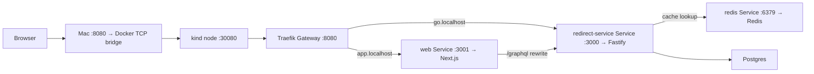

# Local Kubernetes and networking

[Project overview](../README.md) · Run commands from the repository root.

## Run in local Kubernetes

With Colima running and `kind` and `kubectl` installed, run:

```sh
pnpm k8s:up
```

Open [Shortlink](http://app.localhost:8080). Created short links use
`http://go.localhost:8080/<code>`. These `.localhost` names resolve to loopback in
modern browsers, so no hosts-file changes are needed.

`k8s:up` builds the application images, loads them into the `shortlink` kind cluster,
starts a separate Postgres with its own volume and a disposable Redis cache, waits for the migration Job,
and deploys Fastify, Next.js, and a Traefik Gateway. It then starts a background
Docker TCP bridge on `127.0.0.1:8080`. You can close the terminal; no interactive
port-forward is required. The kubeconfig stays in the ignored `.kind/` directory,
so the commands do not switch your default Kubernetes context.
The same command also provisions local Prometheus and Grafana monitoring.

The existing kind node was created without a Docker mapping for HTTP traffic.
The bridge connects to its NodePort over Docker's `kind` network, preserving the
cluster and its database. HAProxy forwards TCP bytes; Traefik performs the HTTP
hostname routing inside Kubernetes. Both use pinned image versions.



The Service boxes show routing references. Traefik discovers their pod endpoints
and forwards requests to those pods; Next.js uses the internal API Service address.

Fastify runs with two replicas, declared in `deploy/k8s/apps.yaml`. Each pod runs
its own Node.js process, Postgres pool (maximum five connections), request
coalescing map, Redis read circuit breaker, and metrics registry. Both use the
same Postgres and Redis Services. Two steady-state replicas can therefore open
up to ten pool connections; a rolling update can temporarily add more pods and
connections. Coalescing remains local to each process, so both pods may query
Postgres for the same uncached code.

The existing application Service and Gateway discover both ready pods without
new public addresses. Prometheus discovers both metrics endpoints independently.
This is horizontal application scaling within the same kind node and Colima VM;
it adds no machine capacity and does not protect against a VM restart. The current
validated workload and its environment are recorded in [performance](performance.md).

Inspect replicas and ready application endpoints with:

```sh
kubectl --kubeconfig .kind/kubeconfig -n shortlink get deployment redirect-service
kubectl --kubeconfig .kind/kubeconfig -n shortlink get pods -l app=redirect-service -o wide
kubectl --kubeconfig .kind/kubeconfig -n shortlink get endpointslices \
  -l kubernetes.io/service-name=redirect-service
```

Fastify connects to `redis://redis:6379` through the internal Redis Service. Redis
has no Gateway route or host port. It uses the same image and cache implementation
as Compose: a successful lookup fills the cache for 60 seconds, and an unavailable
cache falls back to Postgres. Fastify readiness still checks Postgres only.
`k8s:up` waits for Redis on startup to catch deployment problems; that startup
check does not make Redis a runtime requirement for serving redirects.

The [Redis manifest](../deploy/k8s/redis.yaml) runs one replica without a PVC, RDB
snapshots, or AOF persistence. Replacing that pod clears the cache; links remain
in Postgres and repopulate Redis on subsequent visits. `Recreate` rollouts avoid
temporarily routing to two independent caches. The 128 MiB container memory limit
is a local resource guard, not a Redis eviction policy or a measured cache capacity.

The local Fastify Deployment enables `REDIS_CACHE_HEADER=1`. To inspect a link
created through the UI, run this twice, replacing `<code>`:

```sh
curl --resolve go.localhost:8080:127.0.0.1 -sS -D - -o /dev/null \
  'http://go.localhost:8080/<code>'
```

The first visit to an uncached link returns the redirect from Postgres and fills
Redis, without an `X-Cache` header. A subsequent visit within its TTL returns
`X-Cache: HIT`. Both responses retain `Cache-Control: no-store`, which controls
browser caching independently of the server's Redis cache. A visit sharing an
in-flight lookup can instead report `X-Cache: COALESCED`.

Inspect Redis inside the cluster, without exposing a new port:

```sh
kubectl --kubeconfig .kind/kubeconfig -n shortlink get pods,services -l app=redis
kubectl --kubeconfig .kind/kubeconfig -n shortlink exec deployment/redis -- redis-cli ping
kubectl --kubeconfig .kind/kubeconfig -n shortlink exec deployment/redis -- \
  redis-cli TTL 'shortlink:redirect:<code>'
```

TTL reports remaining seconds, or `-2` if the key is absent. Existing Grafana
panels show HTTP latency and database-pool state. Redis read-outcome counters are
available in [application metrics](observability.md); a Redis server exporter and
dedicated Redis-server panels are not configured.

Verified through the Gateway on November 12, 2026: cold lookup → cache fill →
`X-Cache: HIT`, correct destination and `no-store` throughout, and a 60-second TTL.
With the Redis Deployment temporarily scaled to zero, redirects still returned
`302` and `/readyz` returned `200`. Restoring its replica produced an empty cache;
the link remained in Postgres, refilled Redis, and returned a cache hit again.
A missing code returned `404` and was not cached. These are functional smoke
checks, not a latency or throughput qualification. The full `k8s:up` also passed;
image builds caused temporary readiness timeouts in the shared Colima VM before
the stack recovered.

The [controller manifest](../deploy/k8s/gateway-controller.yaml) installs Traefik
and gives it permission to read routing resources and report their status.
The [routing manifest](../deploy/k8s/gateway.yaml) separates three concepts:

- `GatewayClass` chooses the implementation: Traefik.
- `Gateway` declares an HTTP listener and permits routes from the same namespace.
- `HTTPRoute` selects the backend Service by hostname. Kubernetes Services still
  provide stable internal destinations while their pods change.

GraphQL stays on the UI's origin: the browser calls `app.localhost:8080/graphql`,
and Next.js forwards to `http://redirect-service:3000/graphql` internally.
The UI's generated short-link origin is compiled by Next.js, so `k8s:up` supplies
`NEXT_PUBLIC_SHORT_LINK_ORIGIN=http://go.localhost:8080` as a Docker build argument.
Setting this variable only on a running web pod would not change its browser bundle.

The first run downloads the pinned Gateway API v1.6.3 standard CRDs into `.kind/`.
The CRDs define the Kubernetes resource types; the running controller makes those
resources work. `k8s:up` waits for the controller, Gateway, and accepted routes,
then checks both public hosts. To reconcile just the Gateway and bridge later:

```sh
pnpm k8s:gateway
```

To stop the local entrypoint while leaving Kubernetes and its data running:

```sh
pnpm k8s:gateway:down
```

Inspect the routing and its controller:

```sh
kubectl --kubeconfig .kind/kubeconfig -n shortlink get pods,services,jobs,pvc
kubectl --kubeconfig .kind/kubeconfig -n shortlink get gatewayclass,gateway,httproute
kubectl --kubeconfig .kind/kubeconfig -n shortlink logs deployment/gateway-controller
docker compose -f deploy/kind/compose.yaml ps
```

The [local manifests](../deploy/k8s/) use a migration Job and separate Fastify
readiness (`/readyz`) and liveness (`/healthz`) probes. The kind database is
independent of the Compose database; deleting the kind cluster also deletes its
local volume. This local Gateway uses HTTP on a loopback port. A deployed setup
would give its Gateway a reachable load balancer and configure DNS and TLS.

`pnpm k8s:forward` remains available for direct debugging on ports 3100 and 3101.
Stop the Compose stack first if it occupies those ports. This optional command
stays in the foreground and stops its forwards when you press Ctrl+C.

Verified locally: existing database rows and PVC survived deployment; the browser
created and copied a `go.localhost` link through GraphQL; visiting that link
returned the correct `302`, `Location`, and `Cache-Control: no-store`. Missing
codes and unmatched hostnames returned `404`. Gateway setup also passed a rerun.
