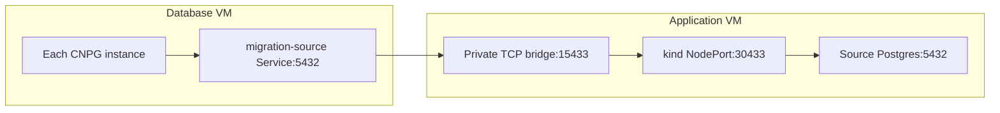

# Source database maintenance bundle

[Migration plan](ha-migration.md) · [Logical replication](database-replication.md)
· [November 15 results](experiments/source-maintenance.md)

**Status: completed on November 15, 2026.** The source is prepared to publish changes. It does not start
real-data replication or change Fastify's database endpoint.

## Changes and interruption boundary

The application Colima profile grows from four CPUs/four GiB to six CPUs/six
GiB. Its disk, kind cluster, Postgres image, PVC and application versions remain.
The dedicated database profile stays at four CPUs/four GiB. Allocations are VM
budgets on one shared Mac; they do not qualify performance at peak overlap.

The source Postgres Pod receives logical WAL settings, a 128 MiB slot-retention
limit, a TLS certificate/key Secret, and a ConfigMap-backed HBA file. Root-owned
key files use mode 0440 and group 999, matching the image's postgres group.
Postgres supports this root-owned, group-readable key arrangement.
[Postgres TLS permissions](https://www.postgresql.org/docs/18/ssl-tcp.html).

A dedicated `shortlink_migrator` login has REPLICATION and SELECT on the two
migration tables, without superuser or INSERT privileges. HBA requires TLS for
that login and rejects its physical-replication connection mode. Existing
application authentication remains available; enabling TLS does not force
Fastify's current connections to adopt it.

The **single continuous interruption starts by closing the public HTTP bridge**.
The coordinator disables its Docker automatic restart policy, stops it, stops
and resizes the application VM, then waits for Kubernetes and applies the source
Postgres change. While the public entrypoint remains closed, it provisions the
role, verifies the reverse path, compares all source table contents and checks
existing redirects through every Fastify pod. It reopens the public bridge only
after successful checks and restores its restart policy.

The UI, API and Grafana behind that bridge are unavailable during this window.
The source Postgres Pod also restarts inside it. The database VM is not stopped.
Preparation and the disposable rehearsal happen before this boundary. There is
no zero-error availability claim for the explicitly planned interruption.

## Reverse network and credentials



The source bridge binds the application VM's private address and accepts the
database VM's source address. It is separate from the public HTTP bridge.
The destination Service has a manually generated EndpointSlice for that VM
address. During rehearsal, the source NodePort selects only the fixture pod;
before the window it selects no pod; after maintenance it selects live Postgres.
Selector changes replace the whole map instead of merging stale keys.

Source Secrets hold the CA key, server key and replication password. Only the
public CA certificate and login password cross to `migration-source-client` in
the database namespace. Private CA/server keys are never copied to the new tier.
Local issuer files are removed after Secret creation.

The checked-in [external-cluster declaration](../deploy/migration/destination-external.json)
references those Secrets. CloudNativePG materializes the trust and mode-0600
password files on all three instances through its native external-server manager.
It does not start a subscription. Files live under
`/controller/external/migration-source/`; clients use `sslmode=verify-full`.
This replaces the previous fixture's primary-only temporary credential files.
[Versioned external-server implementation](https://github.com/cloudnative-pg/cloudnative-pg/blob/v1.30.1/pkg/management/external/external.go).

Endpoint addresses are discovered, not reserved. The maintenance coordinator
checks that they remain unchanged after the VM restart; a mismatch leaves the
entrypoint gated for mapping repair. The bridge is a single dependency, and
password rotation, certificate renewal and failover during an active logical
subscription remain separate exercises. The CA key stays available in the
source CA Secret; renewal should retain trust or coordinate CA rotation and
reload Postgres. No automatic cross-cluster Secret rotation is implemented.

## Rehearsal, backup and WAL allowance

A fresh `pnpm test:db-restore` must pass within one hour before applying the
bundle. Its archive and content manifest remain outside the application VM.
The maintenance coordinator independently compares full-row hashes of links
and migration history before/after the window.

The exact Pod-template patch is first instantiated as a disposable Kubernetes
Pod. It uses an empty data directory, the real schema and generated fixture data,
with the same TLS Secret permissions and HBA ConfigMap as the planned source.
Every CNPG instance must connect successfully, and the checks reject plaintext,
wrong hostname, untrusted CA and wrong password.

The rehearsal takes two 50-write samples at approximately ten creations per
second, forcing a checkpoint before each sample and using URLs at least as long
as the observed source maximum. It records WAL-byte deltas rather than guessing
retention solely from row counts. The chosen initial allowance is a 30-minute
pause at four times the largest measured WAL rate, required to fit inside 128
MiB. The multiplier/window are conservative planning choices, not experimentally
established upper bounds. Small samples do not include every source of WAL.

`max_slot_wal_keep_size` is checkpoint-enforced, not a hard filesystem cap, and
slot invalidation may require repeating the copy. Before a live slot is created,
monitor its retained bytes, disk headroom and subscriber progress. Treat 64 MiB
as investigation threshold and 96 MiB as the stop/re-copy decision point; do not
keep an abandoned slot while protecting the old application's availability.
Those are operating thresholds below the configured limit, not automatic alerts
or automatic slot deletion. The retention limit can be adjusted by reload, so
revising it does not require another VM restart.
[Postgres retention setting](https://www.postgresql.org/docs/18/runtime-config-replication.html#GUC-MAX-SLOT-WAL-KEEP-SIZE).

## Commands and repeat protection

```sh
pnpm db:source:prepare          # Secrets, disabled private endpoint and CNPG files
pnpm test:source-maintenance   # Exact disposable Pod and reverse-path checks
pnpm db:source:maintain         # ACTUAL planned downtime and VM/Postgres restart
pnpm db:source:resume           # Resume a failed, still-gated window; no VM restart
pnpm db:source:check            # Repeatable read-only post-maintenance verification
```

[Coordinator](../scripts/source-maintenance.mjs) ·
[Pod patch](../deploy/migration/source-settings.patch.yaml) ·
[HBA](../deploy/migration/pg_hba.conf) ·
[Role grants](../deploy/migration/source-role.sql) ·
[Network/resource choices](../deploy/migration/source-network.json).

Prepare/rehearse/apply/resume refuse to repeat a recorded completed maintenance window;
use `db:source:check` afterward. The completion ConfigMap also lets ordinary local
startup preserve the configured source settings. Prepared Secrets alone do not
trigger the change through ordinary startup.

Private evidence lives under `.kind/db-cluster/source-maintenance/<timestamp>/`:
preparation, rehearsal, old Deployment, source content manifest, maintenance
state transitions, and one-second HTTP observations. The current pointer contains
no credentials. HTTP sampling bounds observed interruption; it cannot time every
in-flight connection precisely. The controlled bridge-closed interval is recorded
separately from client-observed successes/failures.

If maintenance fails, the coordinator records the gate state and a JSON patch
restoring the old Pod template. Inspect the failure and restore a verified source
before reopening the bridge; do not restore an older data dump over the live PVC
as a routine configuration rollback. Source data and endpoint authority have not
moved, so configuration rollback does not require reverse replication.

## Next increment

Verify the prepared publisher, create the publication/subscription, copy schema
and real rows, and compare ongoing source/destination contents with explicit
lag/WAL monitoring. Keep the original database as the only application writer.
No application cutover or real-data stream is part of this maintenance bundle.
