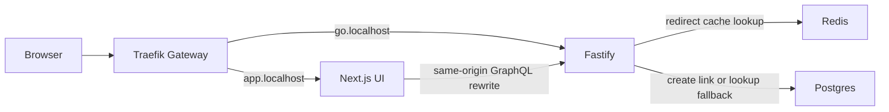

# System design and implemented patterns

[Project overview](../README.md) · Run commands from the repository root.

This guide maps the design to the code that exists today. Postgres is the source
of truth for links. Redis is a disposable performance layer. The local deployment
has two Fastify replicas, one Postgres instance and one Redis instance on a
single kind node inside Colima.

## Request flow

The local HAProxy bridge connects Mac port 8080 to the kind node's NodePort.
Traefik selects the HTTP backend using the hostname. A browser creates links
through Next.js's `/graphql` rewrite and visits short links on the Fastify host.
[Networking details](kubernetes.md) include the Services and Gateway resources.

## Shared application logic and a repository boundary

REST and GraphQL call `createLinkCreator`, which owns URL validation, random
code generation and collision handling. The creator receives a link store and
can receive a code generator, making its behavior testable without a real
Postgres server. `createLinkStore` contains the Drizzle queries; HTTP handlers
translate creation results into their transport's responses.

This keeps creation policy consistent between the UI and REST API. It is a small
application-service/repository separation, with explicit dependencies rather
than a dependency-injection framework.

Code: [creator](../apps/redirect-service/src/link-creation.ts),
[REST](../apps/redirect-service/src/links.ts),
[GraphQL](../apps/redirect-service/src/graphql.ts),
[store](../packages/db/src/links.ts).

## Connection pooling and bounded admission

Each Fastify process owns a Postgres pool with a default maximum of five
connections. Requests borrow and release clients instead of opening a connection
for each query. Two steady-state replicas can therefore use up to ten pool
connections; a rollout can temporarily add more pools.

Redirect lookups have an additional admission check: reject a new checkout if
128 checkouts are already waiting, or if acquisition takes at least 50ms. The
HTTP handler returns `503`. This is load shedding based on current contention
and elapsed time. It does not set a fixed requests-per-second rate limit.

Creation and readiness checks share the pool and bypass the redirect guard, so
this is not a separate bulkhead reserving connections for writes. A rejected
checkout can remain in pg's queue until settlement; a client arriving afterward
is released without executing the expired request's lookup. Event-loop delays
can also cause an acquisition to exceed the deadline.

Code: [pool](../apps/redirect-service/src/database.ts),
[admission guard](../apps/redirect-service/src/redirect-admission.ts),
[client ownership and release](../packages/db/src/links.ts),
[rejection response](../apps/redirect-service/src/redirect.ts).

## Cache-aside with TTL and fallback

The application explicitly reads Redis before querying Postgres. A successful
Postgres lookup after a confirmed cache miss fills `shortlink:redirect:<code>`
for 60 seconds. Only existing links are cached; `404`s are not cached, so a miss
cannot hide a subsequently created link for the cache TTL.

A failed or unavailable Redis read falls back to Postgres. This makes Redis an
optional performance dependency, while Postgres remains authoritative. Failed
reads do not trigger a cache fill; a confirmed miss is required. The database
fallback still has capacity limits, so losing the cache can increase latency
and rejections under load.

The browser receives `302` and `Cache-Control: no-store`. That browser policy is
independent of the server-side Redis cache. Link creation currently writes
Postgres only; it does not pre-warm Redis.

Code: [cache wrapper](../apps/redirect-service/src/redirect-cache.ts),
[redirect semantics](../apps/redirect-service/src/redirect.ts),
[ephemeral Redis deployment](../deploy/k8s/redis.yaml).

## Request coalescing

Concurrent fallbacks for the same code share one in-flight lookup promise in a
process-local map. This limits duplicate database work during a hot-key miss,
expiry or Redis outage. Followers receive the same result or failure; a single
rejected checkout can therefore cause several HTTP `503`s.

The map entry is removed when the lookup settles. Different codes still require
their own lookups, and different Fastify pods can each start a lookup for the
same code. There is no distributed lock or cross-pod coalescing coordinator.

Code: [pending lookups](../apps/redirect-service/src/redirect-cache.ts).
The [integration tests](../apps/redirect-service/test/integration/links.test.ts)
exercise shared lookups and failure recovery.

## Redis read circuit breaker

After five consecutive read failures, a process opens its Redis read circuit
for one second. Requests use the database fallback during that cooldown. One
request is then allowed to probe Redis while concurrent requests keep falling
back. A successful hit or miss closes the circuit; a failed probe restarts the
cooldown.

State objects identify the attempt generation, so late results from an older
state cannot change a newer recovery decision. Each pod owns its own breaker;
it protects Redis reads and does not implement a Postgres breaker. Coalescing
and database admission remain active on the fallback path. The breaker has
been instrumented and tested; further tuning is deferred.

Code: [state machine](../apps/redirect-service/src/redis-read-breaker.ts),
[cache integration](../apps/redirect-service/src/redirect-cache.ts),
[state-transition tests](../apps/redirect-service/test/redis-read-breaker.test.ts).

## Database-enforced uniqueness and bounded retries

Six cryptographically random bytes become an eight-character URL-safe code.
Postgres's unique constraint is the final arbiter of uniqueness. Creation uses
`ON CONFLICT (code) DO NOTHING RETURNING ...`; a collision triggers another
candidate, with at most three attempts. Other database errors are surfaced.

This avoids a race-prone check-then-insert sequence and prevents overwriting an
existing link. The API is not an idempotent-create API: repeating a successful
creation request can produce another link for the same destination.

Code: [random codes and retry bound](../apps/redirect-service/src/link-creation.ts),
[unique constraint](../packages/db/src/schema.ts),
[conflict handling](../packages/db/src/links.ts).

## Stateless HTTP replicas and shared storage

Any ready Fastify pod can create or resolve a link because durable link data is
shared in Postgres and cache entries are shared in Redis. A client does not need
a sticky session tied to a particular Fastify pod.

Pools, in-flight maps, breaker state and metric registries remain process-local.
Replacing a pod resets that transient state while links remain available through
shared storage. The two-pod setup demonstrates horizontal application scaling;
the Colima change from two to four CPUs demonstrates vertical VM scaling. Both
pods still share one machine's resources and failure boundary.

Code: [application wiring](../apps/redirect-service/src/app.ts),
[replicas and internal Services](../deploy/k8s/apps.yaml),
[Gateway routing](../deploy/k8s/gateway.yaml),
[same-origin rewrite](../apps/web/next.config.ts).

## Health probes, drain and graceful shutdown

`/healthz` checks the HTTP process and `/readyz` queries Postgres with `SELECT 1`.
Redis availability does not control readiness. A successful probe is one signal;
it does not prove every link lookup is meeting its latency target.

During termination, the five-second `preStop.sleep` hook keeps Fastify serving
while endpoints are withdrawn and routing updates propagate. `SIGTERM` then
invokes `app.close()`, which finishes accepted work and closes the metrics
listener, Redis client and database pool. The total termination grace is 30
seconds, including the pre-stop wait. Rolling updates preserve two available
replicas and allow one extra non-terminating replica.

Code: [probes, rollout policy and drain](../deploy/k8s/apps.yaml),
[signals](../apps/redirect-service/src/server.ts),
[shutdown hooks](../apps/redirect-service/src/app.ts).
[Recorded trials](experiments/rolling-restarts.md) explain why the drain and CPU
allocation were introduced and the scope in which they passed.

## Versioned artifacts and verified rollback

CI builds tested commits into GHCR images for AMD64 and ARM64, with a full
commit-SHA tag and baked revision. Registry deployments select and pin the node
platform digest. An explicit local build path uses `git archive` for an exact
committed snapshot. The deployment workflow records
and checks image digests as well as each pod's own build-info metric. Rollback
restores a retained pod template and verifies the previous artifact in every
serving replica.

Git revisions identify source; Kubernetes revisions identify rollouts. Rollback
does not undo database migrations. Commit tags can move on a CI rerun; digest references preserve the selected
artifact. A registry-enforced immutable-tag policy is not configured.

Code: [release commands](../scripts/release-redirect.mjs),
[verification rules](../scripts/lib/redirect-release.mjs),
[image metadata](../Dockerfile).
The [delivery guide](delivery.md) covers CI, commands and the verified A/B exercise.

## Per-pod observability and client-measured targets

Each process exposes its own registry on an internal port 9090. Prometheus
scrapes pod endpoints individually, and Grafana can aggregate them or show each
pod. HTTP metrics use route templates rather than short codes, keeping label
cardinality bounded. Checkout counters retain short rejection bursts that a
five-second pool-queue gauge can miss.

Client-side tests include response correctness in the latency budget. Server
histogram percentiles are diagnostic signals; they do not replace end-to-end
checks of `302`, destination and timing. CPU/memory pressure metrics help separate
VM resource contention from application behavior.

Code: [metrics](../apps/redirect-service/src/metrics.ts),
[discovery](../deploy/monitoring/prometheus.yaml),
[latency-budget workload](../benchmarks/latency-budget.js),
[restart workload](../benchmarks/rolling-restart.js).
See [observability](observability.md) and [performance](performance.md).

## Discussed but not implemented

- Warming Redis on successful link creation.
- Postgres replication/failover and a read-after-write policy for replica reads.
- A demonstrated expand/backfill/contract schema migration across app versions.
- Automatically deploying CI-published images (local deployment is manual).

The current Postgres Deployment has one instance and a persistent volume.
Adding ordinary Deployment replicas would not configure replication or failover.
